# KB Creation Framework v3.1.0 — High-Level Overview

**Version:** 3.1.0 — 2026-06-07
**Audience:** Operators, reviewers, and stakeholders who need to understand *what the framework does and why* without reading the full normative spec.
**Companion documents:** `technical-specification-v3.1.0.md` (normative), `..\HOW-TO-USE.md` (operator runbook).

---

## 1. The problem this system solves

LLMs are very good at producing plausible-sounding knowledge bases and very bad at admitting they don't know something. A single-model, single-pass KB will reliably contain:

- **Fabricated specifics** — vendor names, statute sub-paragraphs, dollar amounts, dates, holdings — that look correct because they pattern-match training data.
- **Silent paraphrase-drops** — qualifiers, exceptions, and threshold variants that the primary source preserved but the summary lost.
- **Register confusion** — the model's interpretation presented as the regulator's rule, with no marker to tell a downstream reader which is which.
- **No audit trail** — nothing to show what was verified, by whom, against what, or what was deliberately left unresolved.

The KB Creation Framework exists to produce **practitioner-grade knowledge bases that a lawyer, compliance officer, or engineer can actually rely on** — with every claim either verified against a primary source, traceable to a cited source, explicitly tagged as unresolved, or removed. No silent hedging. No invented institutional facts. No view confusion.

## 2. How it achieves that — the four safety strategies

The framework is built around four reinforcing strategies. The whole pipeline is just the mechanical implementation of these four ideas:

1. **Independence.** Two builder agents from different model families draft the KB independently; they never see each other's work until reconciliation. Critics and fact-checkers come from yet different families. No model ever grades its own output. (Six Rules #3, #4, #6.)

2. **Provenance.** Every phase writes a persistent artifact. Every tag transition is logged append-only. Every cite must identify its source well enough to retrieve. Builder drafts, comparison reports, fact-check reports, and lint reports are preserved — not just the final KB. (PV-1 through PV-5.)

3. **Register separation.** Authority text (rule text, citations, operative numerics) is tagged differently from `<!-- [GUIDANCE] -->` (operational practice) and `<!-- [INTERPRETATION] -->` (synthesis). Three views are deterministically extracted: `full/` (everything), `practice/` (authority + guidance), `authority/` (authority only). Downstream cite-bearing work draws from `authority/`. (See §5 of the spec.)

4. **Mechanical gates.** Scripts — not model judgment — enforce structural rules: `Validate-ModelAssignment.ps1`, `Register-Lint.ps1`, `Verbatim-Linter.ps1`, `Extract-PracticeView.ps1`, `Extract-AuthorityView.ps1`, `Generate-QualityScorecard.ps1`, `Detect-Reattribution.ps1`, and others. A model can argue its way past a reviewer; it cannot argue its way past a linter exit code.

Anti-fabrication, in this system, is not a prompt instruction. It is an architecture.

## 3. Inputs, outputs, and what an operator actually does

### Inputs
- A scoping conversation with the Lead (audience, use case, source hierarchy, KB type).
- A model assignment (chosen from presets or custom; validated for Rule 19 family separation).
- A host capability declaration (Copilot CLI L1a, OpenCode L3 pending, etc.).
- The primary sources themselves — statutes, regulations, contracts, standards, filings.

### Outputs (a shipped KB)
- **Root files:** `AGENTS.md`, `index.md`, `table-of-authorities.md`, optional `qualifier-registry.md`.
- **Three content views:** `full/`, `practice/`, `authority/` — each topic has a peer file in all three.
- **`sources/`:** every artifact every phase produced, plus the pipeline state file and manifests for new claims, unresolved/unverified claims, and `[VOLATILE:*]` tags.
- **`audit/`:** the Quality Scorecard (human-readable + JSON companion + history), the final audit report, and downstream stress-test results.
- **`learned/`:** corrections, open questions, refresh notes.

### What the operator does
Start the Lead session on `prompts\01-orchestrator.md`. The orchestrator runs the 22 numbered phases in order; the operator dispositions findings, approves any logged exceptions, and reviews the Quality Scorecard at the end. The operator does **not** decide which phases to skip — the framework's Rule 5 ("No Silent Skipping") binds the Lead as much as the operator.

## 4. End-to-end flow

The pipeline has 22 numbered phases. Grouped by purpose, it looks like this:

```mermaid
flowchart TD
    Start([Operator starts Lead session on<br/>prompts/01-orchestrator.md])

    subgraph Setup[" Setup &mdash; Phases 0.0 - 0.2 "]
        P00[0.0 Select &amp; validate<br/>per-build model assignment<br/><i>Validate-ModelAssignment.ps1</i>]
        P01[0.1 Scope KB, audience,<br/>sources, Tier A/B density]
        P02[0.2 Independent critic<br/>pressure-tests scoping]
        P00 --> P01 --> P02
    end

    subgraph Draft[" Independent drafting &mdash; Phases 1.1 - 3.0 "]
        P11[1.1 Builder A &amp; Builder B<br/>research topics independently<br/><b>no cross-visibility</b>]
        P12[1.2 Independent critic<br/>pressure-tests merged topic list]
        P13[1.3 Builders draft per-topic<br/><b>still isolated</b>]
        P20[2.0 Lead reviews each builder<br/>&#40;structural + depth&#41;]
        P30[3.0 Builders revise v1 drafts<br/>from Lead review]
        P11 --> P12 --> P13 --> P20 --> P30
    end

    subgraph Reconcile[" Reconciliation &mdash; Phase 4.0 "]
        P40[4.0 Lead compares v2 drafts,<br/>builds single-source claim inventory,<br/>checks revision compliance<br/><i>Validate-Phase4Inventory.ps1</i>]
    end

    subgraph FactCheck[" Parallel fact-check cluster &mdash; Phases 5.1 - 5.5 "]
        P51[5.1 Currency &amp;<br/>operative-hook check]
        P52[5.2 Citation verification<br/>grounding default-on<br/><i>Verbatim-Linter.ps1</i>]
        P53[5.3 Classification check]
        P54[5.4 Single-source<br/>inventory verification<br/><b>independent of 5.2</b>]
        P55[5.5 Operative-mechanism &amp;<br/>cross-reference fidelity]
    end

    subgraph Assemble[" Assembly, lint, extraction &mdash; Phases 6.0 - 6.3 "]
        P60[6.0 Lead assembles KB +<br/>new-claims, unresolved, and<br/>volatile-tag manifests]
        P61[6.1 Independent critic<br/>pressure-tests assembled KB]
        P62[6.2 Register-Lint +<br/>Verbatim-Linter on full/]
        P63[6.3 Extract practice/ &amp; authority/<br/>validate structure &amp; filenames<br/><i>Extract-PracticeView/AuthorityView.ps1</i>]
        P60 --> P61 --> P62 --> P63
    end

    subgraph PostAssembly[" Post-assembly verification &mdash; Phases 6.4 - 6.5 "]
        P64[6.4 Superset fact-check<br/>of assembled full/]
        P65[6.5 A/B/C quality-tier audit<br/>+ mandatory deepening]
        P64 --> P65
    end

    subgraph Audit[" Final audit &mdash; Phase 7.0 "]
        P70[7.0 Auditor produces final report +<br/>Quality Scorecard<br/>&#40;human MD + JSON + history&#41;<br/><i>Generate-QualityScorecard.ps1</i>]
    end

    subgraph Stress[" Downstream stress tests &mdash; Phases 8.0 - 8.5 "]
        P80[8.0 Cooperative memo stress test<br/>via Memo Drafting Framework<br/>&#40;uses authority/ only&#41;]
        P85[8.5 Adversarial red-team:<br/>unresolved items, guidance-only<br/>entities, guidance-as-rule misuse]
        P80 --> P85
    end

    Ship([ Shipped KB: full/, practice/, authority/<br/>+ sources/, audit/, learned/ ])

    Start --> Setup
    Setup --> Draft
    Draft --> Reconcile
    Reconcile --> P51
    Reconcile --> P52
    Reconcile --> P53
    Reconcile --> P54
    Reconcile --> P55
    P51 --> Assemble
    P52 --> Assemble
    P53 --> Assemble
    P54 --> Assemble
    P55 --> Assemble
    Assemble --> PostAssembly
    PostAssembly --> Audit
    Audit --> Stress
    Stress --> Ship

    classDef gate fill:#ffe9e9,stroke:#c33,stroke-width:1px;
    class P00,P40,P63,P70 gate;
```

**Reading the flowchart.** The four red-tinted phases are the hard mechanical gates: model assignment must validate before any drafting; the single-source inventory must validate before fact-check 5.4/6.4 can consume it; the extraction scripts must succeed before ship; and the final audit must produce a Quality Scorecard before the build is considered complete. Every phase writes to `sources/pipeline_state.md` with status, model, family, timestamps, and any logged exceptions. No phase can be silently skipped — every skip requires explicit human approval and compensating controls recorded in state.

## 5. The three views, briefly

The output architecture is the single most operator-visible safety feature, so it is worth restating:

| View | Contains | Stripped | Use it for |
|---|---|---|---|
| `full/` | Authority + guidance + interpretation | Nothing | Maintenance, refresh, audit, context |
| `practice/` | Authority + guidance | Interpretation | Operational practice questions |
| `authority/` | Authority only | Guidance + interpretation | **Cite-bearing memos and deliverables** |

The Memo Drafting Framework (sibling project) consumes `authority/` plus `index.md` and `table-of-authorities.md`. Testing the work-product agent against `full/` would defeat the whole register-separation design — see invariant AF-7.

## 6. What changed in v3.1 vs. v3.0

v3.1 is **additive**. A v3.0-conformant KB remains v3.1-conformant. v3.1 adds:

- **Model Provider Abstraction** — a Model Registry (`model-registry.yaml`) plus four provider adapters (Copilot CLI, Azure Foundry, OpenRouter, Ollama). Family membership for Rule 19 is now declared on the registry entry, so a GPT-family model reached through Azure Foundry and the same family reached through OpenRouter are correctly counted as one family.
- **Host Contract** — `HOST-CONTRACT.md` defines required host capabilities and L1a/L1b/L2/L3 degradation semantics. Copilot CLI is L1a-verified; OpenCode is L3 pending runtime promotion.
- **Phase 0.0 sub-flows** — preset, custom, discover-and-add, and recommend-per-role flows for model selection.
- **Domain-aware recommendations** — `Recommend-Models.ps1` shows OpenRouter category signals and benchmark-derived `domain-capabilities.yaml` signals side by side.
- **Nine usability scripts** — setup, resumption, status, cost estimates, recommendation, category discovery, diagnostics, notifications.

See `..\CHANGELOG.md` for the full change list.

## 7. Where to go next

- **Operator runbook:** `..\HOW-TO-USE.md`
- **Normative spec:** `technical-specification-v3.1.0.md`
- **Rulebooks:** `..\01-shared-axioms.md` through `..\07-audit-system.md`
- **Prompt inventory:** `..\prompts\00-README.md`
- **Host capability contract:** `..\HOST-CONTRACT.md`
- **Sibling memo framework:** `..\..\Memo Drafting Framework v1 + Provider Registry\HOW-TO-USE.md`
