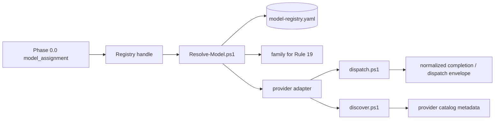
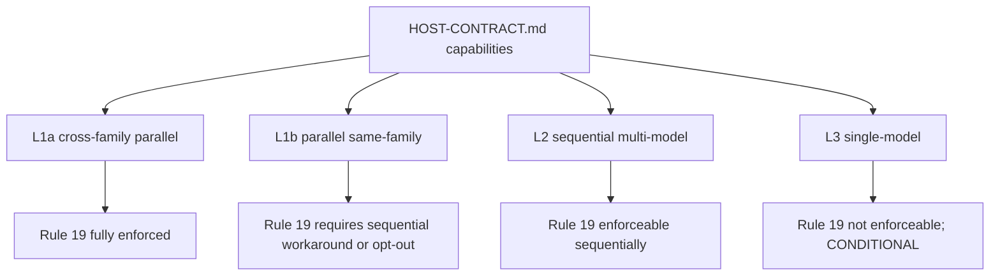

# KB Creation Framework v3.1.0 — Technical Specification

**Version:** Specification v3.1.0 — 2026-06-07  
**Date:** 2026-06-07  
**Status:** Normative v3.1.0 specification. v3.1.0 is additive and preserves v3.0 conformance while adding Model Provider Abstraction, Host Contract, domain-aware model recommendation, and usability scripts.  
**Supersedes:** `specification\technical-specification-v3.0.md` for new v3.1 work.  
**Framework root:** `KB Creation - Modular v3 + OpenCode and OpenRouter\`  
**Sibling framework:** `Memo Drafting Framework v1 + Provider Registry\`

---

## 0. Document metadata

### 0.1 Purpose

This specification defines the KB Creation Framework v3.1.0 build pipeline, artifacts, roles, quality gates, model-selection subsystem, three-tier output architecture, audit/scorecard subsystem, KB-type override mechanism, v2/v3.0 migration path, Model Provider Abstraction, Host Contract, domain-aware recommendation subsystem, usability scripts, and integration contract with the sibling Memo Drafting Framework v1 + Provider Registry. It is detailed enough that an independent implementer can reproduce a conformant v3 pipeline while an operator can use the prompt files as the executable implementation.

The framework's design goal remains **anti-fabrication through provenance, independent verification, register separation, and auditability**. v3 makes several safety mechanisms mechanical and visible: model assignment is selected and validated before scoping, source grounding is default-on for key fact-check phases, volatile/unverified tags are preserved through assembly, three views are generated deterministically, and the final Quality Scorecard gives reviewers a single reliance artifact.

### 0.2 Conformance terminology

The key words **MUST**, **MUST NOT**, **REQUIRED**, **SHALL**, **SHALL NOT**, **SHOULD**, **SHOULD NOT**, **RECOMMENDED**, **MAY**, and **OPTIONAL** are to be interpreted as described in RFC 2119 and RFC 8174 when, and only when, they appear in all capitals.

### 0.3 Authoritative sources

- `CHANGELOG.md` — authoritative change list.
- `HOST-CONTRACT.md` — authoritative host-capability contract for v3.1.
- `hosts\copilot-cli\HOST-NOTES.md` and `hosts\opencode\HOST-NOTES.md` — host-specific evidence notes.
- `hosts\README.md` — supported-host index and capability matrix.
- `model-registry.example.yaml` and `audit-templates\model-registry.schema.json` — Model Registry starter config and schema.
- `adapters\model-providers\README.md` — shared provider adapter contract for `dispatch.ps1` and `discover.ps1`, including parameters, JSON envelope schemas, and error semantics.
- `adapters\model-providers\copilot-cli\README.md`, `adapters\model-providers\azure-foundry\README.md`, `adapters\model-providers\openrouter\README.md`, and `adapters\model-providers\ollama\README.md` — provider-specific adapter instructions.
- `prompts\00-README.md` — authoritative prompt inventory, final filenames, and v2→v3 mapping.
- `01-shared-axioms.md` through `07-audit-system.md` — rulebooks.
- Root scripts and `audit-templates\` — mechanical enforcement.
- `Memo Drafting Framework v1 + Provider Registry\HOW-TO-USE.md` and `Memo Drafting Framework v1 + Provider Registry\02-corpus-contract.md` — Phase 8.0 integration contract.

### 0.4 Out of scope

The internal/confidential-data framework, UI dashboards, portfolio subscription services, and runtime answer-tracing tools are outside v3.1. v3.1 does not enforce hard budget limits or provider failover. `Estimate-BuildCost.ps1` estimates cost; it does not block builds. Provider secret-manager integrations beyond env-var indirection are deferred.

## 1. v3 change set


**v3.1 change:** v3.1.0 is an additive provider/host abstraction release. The v3.0 18-item change set remains normative below except where explicitly modified by v3.1 change markers. v3.1 adds:

1. **Model Registry layer.** `model-registry.yaml` / `model-registry.example.yaml` store handle → provider, model_id, family, endpoint, api_key env-ref, capabilities, and notes.
2. **Provider adapters.** Four provider adapters ship under `adapters\model-providers\`: `copilot-cli`, `azure-foundry`, `openrouter`, and `ollama`, each with `dispatch.ps1`, `discover.ps1`, `README.md`, and license metadata.
3. **Registry-aware Rule 19.** Family is declared on the registry entry. Cross-provider same-family agreement is NOT cross-family corroboration.
4. **Host Contract.** `HOST-CONTRACT.md` defines required host capabilities and L1a/L1b/L2/L3 degradation semantics.
5. **Two shipped hosts.** Copilot CLI is L1a verified by direct use. OpenCode is source-supported for static multi-model agents but declared L3 until runtime `Validate-Host.ps1` promotion proves atomic writes, four-way concurrency, and structured output capture.
6. **Phase 0.0 sub-flows.** Model selection now supports preset, custom, discover-and-add, and recommend-per-role flows.
7. **Domain-aware recommendations.** `Recommend-Models.ps1` displays OpenRouter category signals and benchmark-derived `domain-capabilities.yaml` signals side-by-side.
8. **Usability scripts.** Nine operator scripts support setup, resumption, status, cost estimates, recommendation, category discovery, diagnostics, and notifications.

1. **Memo Drafting Framework spinoff.** The embedded Grounded Memo Drafter became sibling `Memo Drafting Framework v1 + Provider Registry` with its own HOW-TO, axioms, corpus contract, prompts, and script ownership.
2. **Monotonic phase renumbering.** v2 inserted labels are replaced by 0.0, 0.1, 0.2, 1.1, 1.2, 1.3, 2.0, 3.0, 4.0, 5.1-5.5, 6.0-6.5, 7.0, 8.0, and 8.5.
3. **Prompt consolidation.** The execution prompt set is consolidated into 24 final prompt files, including merged Lead review and merged extraction/filename validation.
4. **Crawl4AI default-on.** Grounding is default-on for Phase 5.2 citation verification and Phase 6.4 post-assembly fact-check; opt-out must be logged.
5. **Verbatim-Linter mainline.** `Verbatim-Linter.ps1` is a root script used by Phase 5.2 and Phase 6.2 for paraphrase-drop and wrong-anchor detection.
6. **Three-tier output.** Every v3 KB has `full/`, `practice/`, and `authority/`; `practice/` strips interpretation only, while `authority/` strips guidance and interpretation.
7. **Claim reattribution check.** `Detect-Reattribution.ps1` detects memo or claim-map rows that cite the right claim id but characterize the source quote incorrectly.
8. **Per-claim volatile refresh cadence.** `[VOLATILE:*]` type, not only KB type or file age, drives refresh cadence and scorecard coverage.
9. **Phase 4 inventory validation.** `Validate-Phase4Inventory.ps1` validates the single-source claim inventory schema before Phase 5.4/6.4 consume it.
10. **Quality Scorecard subsystem.** `Generate-QualityScorecard.ps1` creates the human scorecard, JSON companion, and history file; methodology may be embedded or separated, and badges are optional support artifacts.
11. **KB-type prompt branching.** `prompts/legal/` and `prompts/company/` contain additive overrides for phases 5.1, 5.2, 5.3, 5.5, and 7.0.
12. **Cross-KB conflict detector.** `Detect-CrossKBConflicts.ps1` identifies conflicting claims across KBs in a portfolio; advisory, not a ship gate.
13. **Version diff.** `Diff-KBVersions.ps1` reports added, removed, changed, and register-reclassified claims between builds.
14. **Adversarial Phase 8.5.** `85-adversarial-red-team.md` tests unresolved-item handling, guidance-only entity claims, and guidance-as-rule misuse.
15. **Goldeneye/Sonnet rule.** Default Builder B is Sonnet 4.6; Goldeneye is explicit opt-in through Phase 0.0 when reachable.
16. **Cost-estimate cleanup.** Old dollar cost estimates were removed from `05-build-orchestrator.md` and replaced with token/capacity guidance.
17. **Phase 0.0 model selection.** `00a-model-selection.md`, `Validate-ModelAssignment.ps1`, and `model-presets.yaml` make model assignment explicit and auditable, including Rule 19 opt-outs.
18. **v2 to v3 migration.** `Migrate-V2KBtoV3.ps1` mechanically migrates v2-built KBs to v3-derived views, manifests, and scorecards without model calls.

## 2. Design goals and invariants

The following AF/PV/IN/AU/RF invariants are preserved verbatim from the 2026-06-06 technical specification draft.

### 2.1 Anti-Fabrication invariants (AF-1 through AF-7)

**AF-1 (Verified-or-omitted).** Every factual claim that survives into a shipped KB MUST be either: (a) verified against a primary source and citing it; (b) traceable to a cited source even if not independently verified; (c) explicitly tagged as unresolved (`[UNVERIFIED]`, `[NEEDS-VERIFICATION]`, `[NEW]`, or `[VOLATILE:*]`); or (d) omitted. A conformant implementation MUST NOT silently convert uncertainty into untagged assertion.

**AF-2 (Institutional-fact primary-source requirement).** For any factual claim about a specific real-world institution, vendor, outside firm, internal program, named individual, contract counterparty, or escalation path stated as that organization's actual relationship or posture, a primary source the user could verify is REQUIRED before the claim may be asserted as authority. Absent such a source, the implementation MUST substitute a generic role placeholder ("outside specialist counsel," "the assigned vendor," "the requesting business function") with an explicit `[CONFIRM WITH <FUNCTION>]` tag.

**AF-3 (Three-guardrail rule for illustrative entities).** Named-entity examples MAY appear in `full/` ONLY when ALL THREE of the following are satisfied: (a) the entity name is sourced to a source actually consulted; (b) the example is framed as illustrative rather than as a client-specific relationship; (c) the paragraph is tagged `<!-- [GUIDANCE] -->` or `<!-- [INTERPRETATION] -->` so it is removed from `authority/`.

**AF-4 (Inter-model agreement is not corroboration for named entities).** When two or more builders independently produce the same named-entity claim (vendor, firm, program, individual, product, institutional relationship), this agreement MUST be treated as a *trigger for heightened verification* rather than as corroboration. Such claims MUST receive primary-source verification regardless of inter-builder agreement. Other claim types (statutory citations, dates, quantitative facts) MAY be treated under conventional agreement-reduces-verification logic.

**AF-5 (Exclusion safeguard / Pattern 5).** Before excluding any claim as fabricated, an implementation MUST perform and log at least three distinct targeted searches against primary-source-grade authorities OR confirm the claim is facially impossible under a primary source already read. Implausibility alone MUST NOT be treated as proof of fabrication. (Pattern 5 — overcautious exclusion — is documented as the highest-severity error pattern in `01-shared-axioms.md` because the corrective signal is lost when a real event is removed as a fabrication.)

**AF-6 (Tier-1 primary source required for single-source high-risk claims).** A claim appearing in exactly one builder's draft and classified as high-risk (named-entity, date, dollar amount, statutory cite, holding) MUST be verified against a Tier 1 primary source: official statute text, court opinion, agency publication, regulatory filing, SEC filing, or equivalent. Tier 2 (authoritative secondary, e.g., established legal treatise) is acceptable ONLY if Tier 1 is unavailable AND the Tier 2 source itself cites Tier 1. Tier 3 (general web, news aggregators, Wikipedia) is NEVER sufficient.

**AF-7 (Stress test uses authority view).** Downstream work-product stress tests at Phase 8 MUST use the `authority/` view, not the `full/` view, when register tags are present in `full/`. Testing the work-product agent against `full/` defeats the dual-view design.

### 2.2 Provenance invariants (PV-1 through PV-5)

**PV-1 (Persistent artifact per phase).** Every phase MUST write a persistent artifact under the KB root, normally in `sources/`, before the pipeline proceeds. The artifact is the phase's evidence of completion.

**PV-2 (Pipeline state file).** The pipeline MUST maintain `sources/pipeline_state.md` (or an equivalent structured state file) containing, for each phase: status (PENDING / IN-PROGRESS / PASS / PASS-WITH-FINDINGS / BLOCKED / FAILED / SKIPPED-WITH-APPROVAL), agent identity, model name, model family, start and completion timestamps, any skipped-phase approvals with rationale, major decisions, and next actions.

**PV-3 (Preservation of builds).** Builder drafts, revised drafts, comparison reports, fact-check reports, assembly manifests, lint reports, authority extraction logs, filename validation reports, audit reports, stress-test memos, stress-test reports, and the new-claims / unresolved-unverified / volatile-tag manifests MUST be preserved under `sources/`. Implementations MAY archive these on ship but MUST NOT delete them as part of the build.

**PV-4 (Tag transitions logged).** Any removal or conversion of `[UNVERIFIED]`, `[NEEDS-VERIFICATION]`, `[VOLATILE:*]`, `[NEW]`, `[TBD]`, `[CONFIRM]`, or `[DRAFT]` tags MUST be logged with: actor (role + model), file, location (heading + paragraph or line), old text, old tag, new text, new tag/disposition, and rationale. The log MUST be append-only.

**PV-5 (Cite-string sufficiency).** Every source citation in a shipped KB MUST identify the source sufficiently for retrieval: URL, official citation, docket identifier, filing accession number, standard number and version, or equivalent persistent identifier.

### 2.3 Independence invariants (IN-1 through IN-6)

**IN-1 (Builder isolation).** Builder Agent A and Builder Agent B MUST operate independently until Phase 3 (Revision). They MUST NOT see each other's topic proposal (Phase 1a) or v1 draft (Phase 1b) during initial research and drafting.

**IN-2 (No self-grading).** A role MUST NOT verify its own generated content. Generation and verification of the same content MUST be performed by roles with separate context and materially independent failure modes.

**IN-3 (Critic independence).** A Critic MUST be independent from the producer being critiqued and MUST NOT have participated in producing the artifact under critique. Specifically: the Phase 0.5 scoping critic uses a different model family from the Phase 0 scoper and the Lead; the Phase 1a.5 topics critic uses a different family from the Lead and either builder; the Phase 6.25 assembly critic uses a different family from the Lead.

**IN-4 (Fact-Checker independence and contract enforcement).** A Fact-Checker MUST NOT rely on Builder intent, working notes, or builder draft content for inputs the framework specifies as separate artifacts. Specifically, the Phase 5d Fact-Checker MUST consume the single-source claim inventory produced by the Phase 4 comparison; it MUST NOT reconstruct that inventory by reading builder drafts. If the inventory is missing or malformed, the correct behavior is STOP and require Phase 4 remediation.

**IN-5 (Independence documentation).** The implementation MUST document how it satisfies independence: different model families, different providers, deterministic tools, isolated human reviewers, separate context windows, or other mechanisms. The documentation lives in `sources/pipeline_state.md`.

**IN-6 (Independence failure mode).** If required independence cannot be satisfied (model unavailable, family conflict), the implementation MUST stop before the affected phase and surface the constraint. It MAY proceed only with explicit human approval recorded in `sources/pipeline_state.md`, and the downstream audit MUST flag the independence exception.

### 2.4 Auditability invariants (AU-1 through AU-5)

**AU-1 (No silent skip).** No phase MAY be silently skipped. Every phase in §6 runs by default. If an implementation proposes to skip a phase, it MUST record (i) the proposed skip, (ii) the rationale, (iii) the expected risk, (iv) the explicit human approval, and (v) the compensating controls before proceeding. (This is the "No Silent Skipping" rule from `HOW-TO-USE.md` §247-253.)

**AU-2 (Per-phase exit status).** Every phase MUST have one of: PASS / PASS WITH NON-BLOCKING FINDINGS / BLOCKED / FAILED / SKIPPED WITH APPROVAL.

**AU-3 (No downstream override of BLOCKED/FAILED).** A BLOCKED or FAILED phase MUST NOT be treated as completed by a later phase. The pipeline cannot proceed to Phase N+1 if Phase N is BLOCKED or FAILED.

**AU-4 (Append-only logs).** Logs that are designated append-only (`pipeline_state.md`, `verification_log.md`, `audit_trail.md`, `learned/corrections.md`, `learned/open-questions.md`, the framework's `master_audit_log.md`) MUST NOT be edited in place. Corrections MUST be made by adding a later correcting entry.

**AU-5 (Mandatory completion checklist).** The build MUST conclude with a mandatory completion checklist covering: root files exist (AGENTS.md, index.md, table-of-authorities.md), `full/` complete (file count matches scoping report; no file below 12KB), `authority/` regenerated after last `full/` edit and synchronized, all required manifests present, `pipeline_state.md` shows PASS or PASS-WITH-FINDINGS for every phase, all validation reports pass. The checklist is recorded as `sources/build_manifest.md`.

### 2.5 Refresh invariants (RF-1 through RF-4)

**RF-1 (Refresh cycle structure).** A refresh cycle MUST include: staleness scan, content update, verification of changed content, correction-application verification, development-log entry, refresh summary.

**RF-2 (Volatile-tag scan regardless of age).** The refresh pipeline MUST scan and re-verify all `[VOLATILE:*]`-tagged claims regardless of file age. The volatile tag is the signal that the underlying fact moves; file age alone is insufficient.

**RF-3 (Correction-application verification gate).** Before closing a refresh, the implementation MUST verify that corrections recorded in `learned/` files have actually been applied to source KB files when they require source changes. Unapplied corrections logged as `KB impact:` or `should be updated` block refresh closure.

**RF-4 (Cascade on `full/` edit).** Any update to `full/` MUST trigger: register-lint review (if any register tags exist), `authority/` regeneration, filename validation, and verification of changed claims before ship.

### 2.6 v3 implementation notes on preserved invariants

The preserved invariants refer to `authority/` because the v2-era draft only had two views. v3 adds `practice/` as a derived middle tier but does not change the invariant's safety meaning. Any `full/` edit now triggers both practice extraction and authority extraction at Phase 6.3. The mandatory completion checklist is extended in v3 conformance to include `practice/`, Quality Scorecard artifacts, Phase 8.5 red-team output, and model-assignment validation.

The preserved independence text references v2 phase labels in a few parentheticals. The v3 mapping is: Phase 0.5 → 0.2, Phase 1a.5 → 1.2, Phase 6.25 → 6.1, Phase 5d → 5.4, Phase 5e → 5.5, Phase 6b → 6.4, Phase 7 → 7.0, and Phase 8 → 8.0. The substantive invariant remains unchanged.

## 3. The Six Rules

The operator-facing Six Rules are preserved verbatim:

1. **Source-Constrained Specificity** — Never request detail without naming the source type
2. **Zero Tolerance for Fabrication** — Verified or removed. Never flagged, never hedged.
3. **Builder Isolation** — Builders never see each other's output
4. **No Self-Grading** — No model judges its own work
5. **No Silent Skipping** — Every phase runs by default. The Lead does NOT skip, shortcut, or conditionally bypass any phase on its own judgment. Any "skip if…" heuristic in the orchestrator is a flag to pause, surface the proposal to the user, and wait for explicit approval. The user's priority is quality and zero errors — not speed or cost. See 01-shared-axioms.md Rule 17.
6. **Model-Family Separation** — Generation and verification of the same content must use different model families. The Lead and both builders are different families from each other. Critique, fact-check, audit, and stress-test phases use a different family from whoever produced the content being checked. Document the model used at every phase. See 01-shared-axioms.md Section 4 for separation requirements per phase.

### 3.1 v3 operationalization

Rule 5 now covers every monotonic v3 phase. Rule 6 is implemented by Phase 0.0 model selection. A family-separation conflict has an explicit acknowledged opt-out path; silent violation is non-conformant. **v3.1 change:** Rule 6 family accounting is based on Model Registry `family` declarations, not raw model-name inference. A GPT-family model reached through Azure Foundry and a GPT-family model reached through OpenRouter remain the same family for Rule 19 purposes.

### 3.2 Rule 2 and v3 tag preservation

The Rule 2 wording is preserved verbatim because it is the operator-facing rule. v3 implements it through AF-1: unverifiable claims are removed unless they are explicitly preserved as unresolved with source-system tags and routed to the required manifests. What v3 forbids is silent hedging or silently converting uncertainty into authority.

## 4. Implementation inventory

### 4.1 Rulebooks

| File | Function in v3 |
|---|---|
| `01-shared-axioms.md` | Global principles, error taxonomy, model behavior profiles, Rule 19. |
| `02-info-gather.md` | Phase 0.1 scoping, `model_assignment`, Tier A/B topic classification. |
| `03-builder.md` | Builder discipline, depth requirements, and build anti-patterns. |
| `04-fact-checker.md` | Verification modes, quality rating scale, grounding behavior, and audit expectations. |
| `05-build-orchestrator.md` | Pipeline management, sequencing, concurrency, and decision logic. |
| `06-refresh-orchestrator.md` | Refresh-cycle protocol, per-claim volatile cadence, correction verification. |
| `07-audit-system.md` | Quality Scorecard subsystem, audit logs, history trends, and Option C. |

### 4.2 Execution prompt inventory

The final v3 prompt layout is the implementation source of truth. The Phase 0.0 filename is `00a-model-selection.md`; the older tentative `00b-model-selection.md` name is not used.

| Prompt file | Phase | Role | Purpose |
|---|---:|---|---|
| `00a-model-selection.md` | 0.0 | Lead facilitator | Select and validate per-build model assignment. |
| `02-info-gather.md` | 0.1 | Lead / info gatherer | Scope KB, audience, sources, Tier A/B density, and model_assignment. |
| `00b-rubber-duck-scoping.md` | 0.2 | Independent critic | Pressure-test scoping report. |
| `11-builder-research.md` | 1.1 | Builder A/B | Independent topic research and proposed structure. |
| `12-rubber-duck-topics.md` | 1.2 | Independent critic | Pressure-test merged topic list. |
| `13-builder-draft.md` | 1.3 | Builder A/B | Per-topic drafting. |
| `20-lead-review.md` | 2.0 | Lead | Combined structural + depth review. |
| `30-builder-revision.md` | 3.0 | Builder A/B | Revise v1 drafts from Lead review. |
| `40-lead-comparison.md` | 4.0 | Lead | Compare v2 drafts, inventory single-source claims, check revision compliance. |
| `51-factcheck-currency.md` | 5.1 | Fact-checker | Verify currency and operative-hook characterization. |
| `52-factcheck-citations.md` | 5.2 | Fact-checker | Verify citations with grounding default-on + Verbatim-Linter. |
| `53-factcheck-classification.md` | 5.3 | Fact-checker | Verify classifications and categories. |
| `54-factcheck-single-source.md` | 5.4 | Independent checker | Verify Phase 4.0 single-source inventory. |
| `55-factcheck-operative-claims.md` | 5.5 | Independent checker | Verify operative mechanisms and cross-reference fidelity. |
| `60-lead-assembly.md` | 6.0 | Lead | Assemble final KB and required manifests. |
| `61-rubber-duck-assembly.md` | 6.1 | Independent critic | Pressure-test assembled KB. |
| `62-register-lint.md` | 6.2 | Script + Lead | Run Register-Lint + Verbatim-Linter and disposition findings. |
| `63-extraction-and-filename-validation.md` | 6.3 | Scripts + Lead | Extract practice/ and authority/, then validate structure and filenames. |
| `64-post-assembly-factcheck.md` | 6.4 | Independent checker | Superset fact-check of assembled full/. |
| `65-quality-tier-audit.md` | 6.5 | Lead | A/B/C quality tier classification and mandatory deepening. |
| `70-final-audit.md` | 7.0 | Auditor | Final audit and Quality Scorecard generation. |
| `80-downstream-stress-test.md` | 8.0 | Memo Framework + fact-checkers | Cooperative memo stress test. |
| `85-adversarial-red-team.md` | 8.5 | Red-team agents | Adversarial register/unresolved-item stress test. |


KB-type override directories contain additive overlays, not replacements. For legal Topic KBs or Company KBs, the Lead reads the common prompt first and then reads the matching override when one exists.

### 4.3 Mechanical scripts

**v3.1 change:** The table below preserves the v3.0 mechanical script inventory. v3.1 adds Model Registry scripts (`Resolve-Model.ps1`, `Validate-ModelRegistry.ps1`, `Infer-Family.ps1`, `Refresh-Registry.ps1`), nine usability scripts, and provider adapter scripts. Those additions are specified in §§15, 17, and 19.7.


| Script | Required phase(s) | Normative function | Exit / ship effect |
|---|---|---|---|
| `Validate-ModelAssignment.ps1` | 0.0, mid-build override | Parses model-assignment YAML, classifies families, validates Rule 19, writes validation report. | `0` PASS; `1` WARN acknowledged; `2` BLOCK. |
| `Validate-Phase4Inventory.ps1` | 4.0, 6.4 preflight | Validates single-source claim inventory schema. | Nonzero blocks Phase 5.4 / 6.4. |
| `Register-Lint.ps1` | 6.2 | Scans `full/` and root files for untagged guidance/should-language and tag-placement issues. | Findings require disposition. |
| `Verbatim-Linter.ps1` | 5.2, 6.2 | Detects wrong-anchor and paraphrase-drop patterns against cited source text. | Material findings route to correction/removal. |
| `Extract-PracticeView.ps1` | 6.3 | Generates `practice/` by stripping only `INTERPRETATION`; writes extraction report. | Nonzero blocks ship. |
| `Extract-AuthorityView.ps1` | 6.3 | Generates `authority/` by stripping `GUIDANCE` and `INTERPRETATION`; writes extraction report. | Nonzero blocks ship. |
| `Generate-QualityScorecard.ps1` | 7.0, post-8.5 finalization, refresh, patch, migration | Writes scorecard, JSON companion, and history; methodology may be embedded or separated, and badges are optional support artifacts. | Missing scorecard means Phase 7.0/finalization incomplete. |
| `Detect-Reattribution.ps1` | Memo Step 3 / Phase 8 | Detects claim-map reattribution errors. | Nonzero blocks memo delivery. |
| `Diff-KBVersions.ps1` | Rebuild comparison | Structured diff between builds. | Advisory unless made a local gate. |
| `Detect-CrossKBConflicts.ps1` | Portfolio operations | Finds conflicting cross-KB claims. | Advisory. |
| `Migrate-V2KBtoV3.ps1` | v2 migration | Archives v2 authority, regenerates views/manifests, runs scorecard, writes report. | `0` migrated; `1` caveats; `2` cannot migrate. |

## 5. KB artifact model and three-tier output

A conformant v3 KB root contains `AGENTS.md`, `index.md`, `table-of-authorities.md`, optional/required `qualifier-registry.md` depending on KB type, `full/`, `practice/`, `authority/`, `sources/`, `audit/`, and `learned/`.

### 5.1 Register semantics

| Marker | Meaning | Retained in `practice/` | Retained in `authority/` |
|---|---|---:|---:|
| no marker | Authority text: verified facts, rule text, citations, operative numerics. | Yes | Yes |
| `<!-- [GUIDANCE] -->` | Practice guidance, operationally useful but not a single-source rule. | Yes | No |
| `<!-- [INTERPRETATION] -->` | Interpretive synthesis no single authority states alone. | No | No |

Inline-position register tags are invalid. Register tags must appear at the beginning of the tagged paragraph line.

### 5.2 `Extract-PracticeView.ps1` specification

The practice extractor reads `[KB Root]\full\*.md` and writes same-name peers to `[KB Root]\practice\`. It strips paragraphs beginning with `<!-- [INTERPRETATION] -->` and continues stripping until a blank line, Markdown heading, or YAML delimiter. It retains untagged authority paragraphs and `<!-- [GUIDANCE] -->` paragraphs. It writes `sources\practice_view_extraction.md` with per-file full size, practice size, retention ratio, stripped paragraph count, missing-peer count, low-retention warnings, and below-12KB warnings. Every `full/*.md` file MUST have a practice peer.

### 5.3 `Extract-AuthorityView.ps1` specification

The authority extractor reads `full/` and writes same-name peers to `authority/`, stripping both `GUIDANCE` and `INTERPRETATION` paragraphs. Authority is the citation-safe view used by downstream memo drafting and cite-string lookup. `authority/` MUST NOT contain practice-only guidance, interpretive synthesis, or illustrative institutional facts that fail AF-2.

### 5.4 View-selection rules

| Task | Required view |
|---|---|
| Cite-bearing memo or deliverable | `authority/` plus `index.md` and `table-of-authorities.md`; invoke Memo Drafting Framework when the deliverable is a memo. |
| Operational practice question | `practice/`. |
| Maintenance, refresh, audit, or context | `full/` plus `sources/`. |
| Verbatim quote / citation verification | Primary source where available; `authority/` is a KB view, not a substitute for source pull. |

## 6. v3 pipeline state machine

| Phase | Name | Required prompt / module | Required outputs | Blocking gates |
|---:|---|---|---|---|
| 0.0 | Select and validate per-build model assignment | `prompts/00a-model-selection.md` | `sources/model_assignment_candidate.yaml`, `sources/model_assignment_validation.md`, `model_assignment` in scoping/pipeline state | PASS or approved logged exception; no silent skip. |
| 0.1 | Scope KB, audience, sources, Tier A/B density, and model_assignment | `02-info-gather.md` | `sources/scoping_report.md` with scope, audience, kb_type, Tier A/B density, model assignment | PASS or approved logged exception; no silent skip. |
| 0.2 | Pressure-test scoping report | `prompts/00b-rubber-duck-scoping.md` | `sources/rubber_duck_scoping.md` and disposition | PASS or approved logged exception; no silent skip. |
| 1.1 | Independent topic research and proposed structure | `prompts/11-builder-research.md` | `sources/topics_builder_a.md`, `sources/topics_builder_b.md` | PASS or approved logged exception; no silent skip. |
| 1.2 | Pressure-test merged topic list | `prompts/12-rubber-duck-topics.md` | `sources/rubber_duck_topics.md`, merged topic list, human-gate disposition | PASS or approved logged exception; no silent skip. |
| 1.3 | Per-topic drafting | `prompts/13-builder-draft.md` | Builder v1 drafts per topic under `sources/` | PASS or approved logged exception; no silent skip. |
| 2.0 | Combined structural + depth review | `prompts/20-lead-review.md` | Lead review reports per builder | PASS or approved logged exception; no silent skip. |
| 3.0 | Revise v1 drafts from Lead review | `prompts/30-builder-revision.md` | Builder v2 revised drafts | PASS or approved logged exception; no silent skip. |
| 4.0 | Compare v2 drafts, inventory single-source claims, check revision compliance | `prompts/40-lead-comparison.md` | `sources/comparison_report.md`, single-source claim inventory, revision-compliance section | PASS or approved logged exception; no silent skip. |
| 5.1 | Verify currency and operative-hook characterization | `prompts/51-factcheck-currency.md` | `sources/factcheck_currency.md` | PASS or approved logged exception; no silent skip. |
| 5.2 | Verify citations with grounding default-on + Verbatim-Linter | `prompts/52-factcheck-citations.md` | `sources/factcheck_citations.md`, grounding/fetch artifacts where applicable | PASS or approved logged exception; no silent skip. |
| 5.3 | Verify classifications and categories | `prompts/53-factcheck-classification.md` | `sources/factcheck_classification.md` | PASS or approved logged exception; no silent skip. |
| 5.4 | Verify Phase 4.0 single-source inventory | `prompts/54-factcheck-single-source.md` | `sources/factcheck_single_source.md` | PASS or approved logged exception; no silent skip. |
| 5.5 | Verify operative mechanisms and cross-reference fidelity | `prompts/55-factcheck-operative-claims.md` | `sources/factcheck_operative_claims.md` | PASS or approved logged exception; no silent skip. |
| 6.0 | Assemble final KB and required manifests | `prompts/60-lead-assembly.md` | Assembled root files, `full/`, `sources/new_claims_manifest.md`, `sources/unresolved_unverified_manifest.md`, `sources/volatile_tag_manifest.md` | PASS or approved logged exception; no silent skip. |
| 6.1 | Pressure-test assembled KB | `prompts/61-rubber-duck-assembly.md` | `sources/rubber_duck_assembly.md` and disposition log | PASS or approved logged exception; no silent skip. |
| 6.2 | Run Register-Lint + Verbatim-Linter and disposition findings | `prompts/62-register-lint.md` | `sources/register_lint_report.md`, `sources/verbatim_lint_report.md` | PASS or approved logged exception; no silent skip. |
| 6.3 | Extract practice/ and authority/, then validate structure and filenames | `prompts/63-extraction-and-filename-validation.md` | `practice/`, `authority/`, extraction reports, `sources/filename_validation.md` | PASS or approved logged exception; no silent skip. |
| 6.4 | Superset fact-check of assembled full/ | `prompts/64-post-assembly-factcheck.md` | `sources/post_assembly_factcheck.md` | PASS or approved logged exception; no silent skip. |
| 6.5 | A/B/C quality tier classification and mandatory deepening | `prompts/65-quality-tier-audit.md` | `sources/quality_tier_audit.md` and deepening artifacts | PASS or approved logged exception; no silent skip. |
| 7.0 | Final audit and Quality Scorecard generation | `prompts/70-final-audit.md` | `sources/audit_report.md`, `audit/kb-quality-scorecard.md`, `audit/kb-quality.json`, `audit/kb-quality-history.json` | PASS or approved logged exception; no silent skip. |
| 8.0 | Cooperative memo stress test | `prompts/80-downstream-stress-test.md` | `sources/stress_test_memos_index.md`, per-memo Memo Framework outputs, independent verification reports | PASS or approved logged exception; no silent skip. |
| 8.5 | Adversarial register/unresolved-item stress test | `prompts/85-adversarial-red-team.md` | `sources/adversarial_stress_test_report.md` | PASS or approved logged exception; no silent skip. |

### 6.1 Phase-by-phase normative details

#### Phase 0.0 — Select and validate per-build model assignment

**Driver:** `00a-model-selection.md` (Lead facilitator). **Required output:** `sources/model_assignment_candidate.yaml`, `sources/model_assignment_validation.md`, `model_assignment` in scoping/pipeline state. The Lead MUST update `sources/pipeline_state.md` with status, model, family, input paths, output paths, and exceptions.

The Lead loads `audit-templates/model-presets.yaml`, offers Standard, Budget, Single-Family Anthropic, Single-Family OpenAI, or Custom, writes the candidate YAML, runs `Validate-ModelAssignment.ps1`, and proceeds only on PASS or acknowledged WARN.

#### Phase 0.1 — Scope KB, audience, sources, Tier A/B density, and model_assignment

**Driver:** `02-info-gather.md` (Lead / info gatherer). **Required output:** `sources/scoping_report.md` with scope, audience, kb_type, Tier A/B density, model assignment. The Lead MUST update `sources/pipeline_state.md` with status, model, family, input paths, output paths, and exceptions.

Scoping MUST define `kb_type`, audience, use case, source hierarchy, topic candidates, boundaries, error thresholds, model assignment, and Tier A/B density by topic.

#### Phase 0.2 — Pressure-test scoping report

**Driver:** `00b-rubber-duck-scoping.md` (Independent critic). **Required output:** `sources/rubber_duck_scoping.md` and disposition. The Lead MUST update `sources/pipeline_state.md` with status, model, family, input paths, output paths, and exceptions.

This phase is required by default. Completing the model prompt without writing the required artifact is not completion.

#### Phase 1.1 — Independent topic research and proposed structure

**Driver:** `11-builder-research.md` (Builder A/B). **Required output:** `sources/topics_builder_a.md`, `sources/topics_builder_b.md`. The Lead MUST update `sources/pipeline_state.md` with status, model, family, input paths, output paths, and exceptions.

This phase is required by default. Completing the model prompt without writing the required artifact is not completion.

#### Phase 1.2 — Pressure-test merged topic list

**Driver:** `12-rubber-duck-topics.md` (Independent critic). **Required output:** `sources/rubber_duck_topics.md`, merged topic list, human-gate disposition. The Lead MUST update `sources/pipeline_state.md` with status, model, family, input paths, output paths, and exceptions.

This phase is required by default. Completing the model prompt without writing the required artifact is not completion.

#### Phase 1.3 — Per-topic drafting

**Driver:** `13-builder-draft.md` (Builder A/B). **Required output:** Builder v1 drafts per topic under `sources/`. The Lead MUST update `sources/pipeline_state.md` with status, model, family, input paths, output paths, and exceptions.

This phase is required by default. Completing the model prompt without writing the required artifact is not completion.

#### Phase 2.0 — Combined structural + depth review

**Driver:** `20-lead-review.md` (Lead). **Required output:** Lead review reports per builder. The Lead MUST update `sources/pipeline_state.md` with status, model, family, input paths, output paths, and exceptions.

This phase is required by default. Completing the model prompt without writing the required artifact is not completion.

#### Phase 3.0 — Revise v1 drafts from Lead review

**Driver:** `30-builder-revision.md` (Builder A/B). **Required output:** Builder v2 revised drafts. The Lead MUST update `sources/pipeline_state.md` with status, model, family, input paths, output paths, and exceptions.

This phase is required by default. Completing the model prompt without writing the required artifact is not completion.

#### Phase 4.0 — Compare v2 drafts, inventory single-source claims, check revision compliance

**Driver:** `40-lead-comparison.md` (Lead). **Required output:** `sources/comparison_report.md`, single-source claim inventory, revision-compliance section. The Lead MUST update `sources/pipeline_state.md` with status, model, family, input paths, output paths, and exceptions.

This phase is required by default. Completing the model prompt without writing the required artifact is not completion.

#### Phase 5.1 — Verify currency and operative-hook characterization

**Driver:** `51-factcheck-currency.md` (Fact-checker). **Required output:** `sources/factcheck_currency.md`. The Lead MUST update `sources/pipeline_state.md` with status, model, family, input paths, output paths, and exceptions.

The Phase 5 fact-check cluster runs in parallel after Phase 4.0. Phase 5.4 and 5.5 MUST be independent from Phase 5.2 unless Phase 0.0 logged an opt-out. Legal/company overrides are additive.

#### Phase 5.2 — Verify citations with grounding default-on + Verbatim-Linter

**Driver:** `52-factcheck-citations.md` (Fact-checker). **Required output:** `sources/factcheck_citations.md`, grounding/fetch artifacts where applicable. The Lead MUST update `sources/pipeline_state.md` with status, model, family, input paths, output paths, and exceptions.

The Phase 5 fact-check cluster runs in parallel after Phase 4.0. Phase 5.4 and 5.5 MUST be independent from Phase 5.2 unless Phase 0.0 logged an opt-out. Legal/company overrides are additive.

#### Phase 5.3 — Verify classifications and categories

**Driver:** `53-factcheck-classification.md` (Fact-checker). **Required output:** `sources/factcheck_classification.md`. The Lead MUST update `sources/pipeline_state.md` with status, model, family, input paths, output paths, and exceptions.

The Phase 5 fact-check cluster runs in parallel after Phase 4.0. Phase 5.4 and 5.5 MUST be independent from Phase 5.2 unless Phase 0.0 logged an opt-out. Legal/company overrides are additive.

#### Phase 5.4 — Verify Phase 4.0 single-source inventory

**Driver:** `54-factcheck-single-source.md` (Independent checker). **Required output:** `sources/factcheck_single_source.md`. The Lead MUST update `sources/pipeline_state.md` with status, model, family, input paths, output paths, and exceptions.

The Phase 5 fact-check cluster runs in parallel after Phase 4.0. Phase 5.4 and 5.5 MUST be independent from Phase 5.2 unless Phase 0.0 logged an opt-out. Legal/company overrides are additive.

#### Phase 5.5 — Verify operative mechanisms and cross-reference fidelity

**Driver:** `55-factcheck-operative-claims.md` (Independent checker). **Required output:** `sources/factcheck_operative_claims.md`. The Lead MUST update `sources/pipeline_state.md` with status, model, family, input paths, output paths, and exceptions.

The Phase 5 fact-check cluster runs in parallel after Phase 4.0. Phase 5.4 and 5.5 MUST be independent from Phase 5.2 unless Phase 0.0 logged an opt-out. Legal/company overrides are additive.

#### Phase 6.0 — Assemble final KB and required manifests

**Driver:** `60-lead-assembly.md` (Lead). **Required output:** Assembled root files, `full/`, `sources/new_claims_manifest.md`, `sources/unresolved_unverified_manifest.md`, `sources/volatile_tag_manifest.md`. The Lead MUST update `sources/pipeline_state.md` with status, model, family, input paths, output paths, and exceptions.

Assembly MUST preserve unresolved and volatile tags unless verification justifies removal. Required manifests are `new_claims_manifest`, `unresolved_unverified_manifest`, and `volatile_tag_manifest`.

#### Phase 6.1 — Pressure-test assembled KB

**Driver:** `61-rubber-duck-assembly.md` (Independent critic). **Required output:** `sources/rubber_duck_assembly.md` and disposition log. The Lead MUST update `sources/pipeline_state.md` with status, model, family, input paths, output paths, and exceptions.

This phase is required by default. Completing the model prompt without writing the required artifact is not completion.

#### Phase 6.2 — Run Register-Lint + Verbatim-Linter and disposition findings

**Driver:** `62-register-lint.md` (Script + Lead). **Required output:** `sources/register_lint_report.md`, `sources/verbatim_lint_report.md`. The Lead MUST update `sources/pipeline_state.md` with status, model, family, input paths, output paths, and exceptions.

This phase is required by default. Completing the model prompt without writing the required artifact is not completion.

#### Phase 6.3 — Extract practice/ and authority/, then validate structure and filenames

**Driver:** `63-extraction-and-filename-validation.md` (Scripts + Lead). **Required output:** `practice/`, `authority/`, extraction reports, `sources/filename_validation.md`. The Lead MUST update `sources/pipeline_state.md` with status, model, family, input paths, output paths, and exceptions.

Run `Extract-PracticeView.ps1`, then `Extract-AuthorityView.ps1`, then structural/filename validation. Repeat after every later `full/` edit.

#### Phase 6.4 — Superset fact-check of assembled full/

**Driver:** `64-post-assembly-factcheck.md` (Independent checker). **Required output:** `sources/post_assembly_factcheck.md`. The Lead MUST update `sources/pipeline_state.md` with status, model, family, input paths, output paths, and exceptions.

This phase is required by default. Completing the model prompt without writing the required artifact is not completion.

#### Phase 6.5 — A/B/C quality tier classification and mandatory deepening

**Driver:** `65-quality-tier-audit.md` (Lead). **Required output:** `sources/quality_tier_audit.md` and deepening artifacts. The Lead MUST update `sources/pipeline_state.md` with status, model, family, input paths, output paths, and exceptions.

This phase is required by default. Completing the model prompt without writing the required artifact is not completion.

#### Phase 7.0 — Final audit and Quality Scorecard generation

**Driver:** `70-final-audit.md` (Auditor). **Required output:** `sources/audit_report.md` plus a Phase 7 provisional `audit/kb-quality-scorecard.md`, `audit/kb-quality.json`, and `audit/kb-quality-history.json`. The Lead MUST update `sources/pipeline_state.md` with status, model, family, input paths, output paths, and exceptions.

The auditor produces `sources/audit_report.md` and invokes `Generate-QualityScorecard.ps1`. Before Phase 8.0/8.5, the scorecard may be BUILD-INCOMPLETE solely because stress-test artifacts do not yet exist. A final shipping scorecard MUST be regenerated after Phase 8.5. A prose audit without scorecard artifacts is incomplete.

#### Phase 8.0 — Cooperative memo stress test

**Driver:** `80-downstream-stress-test.md` (Memo Framework + fact-checkers). **Required output:** `sources/stress_test_memos_index.md`, per-memo Memo Framework outputs, independent verification reports. The Lead MUST update `sources/pipeline_state.md` with status, model, family, input paths, output paths, and exceptions.

Phase 8.0 invokes Memo Drafting Framework v1 + Provider Registry through the sibling `Memo Drafting Framework v1 + Provider Registry\02-corpus-contract.md`; KB v3 owns topic selection and remediation routing.

#### Phase 8.5 — Adversarial register/unresolved-item stress test

**Driver:** `85-adversarial-red-team.md` (Red-team agents). **Required output:** `sources/adversarial_stress_test_report.md`. The Lead MUST update `sources/pipeline_state.md` with status, model, family, input paths, output paths, and exceptions.

Phase 8.5 runs attacks for unresolved-item overclaiming, guidance-only entity facts, and guidance-as-rule misuse. Any failure routes to remediation.


## 7. Phase 0.0 model-selection subsystem

**v3.1 change:** Phase 0.0 no longer selects raw provider model IDs from `audit-templates\model-presets.yaml`. Phase 0.0 selects Model Registry handles. `Validate-ModelAssignment.ps1` resolves each handle through `Resolve-Model.ps1` and evaluates Rule 19 using the resolved registry `family`.

`audit-templates\model-presets.yaml` remains canonical for presets, but its role values are registry handles. Current shipped preset keys are `copilot-openrouter-ollama-standard-multi-family`, `openrouter-ollama-budget-multi-family`, `copilot-single-family-anthropic`, and `copilot-single-family-openai`. A conformant assignment includes `preset`, `lead`, `builder_a`, `builder_b`, `critic_pool`, `factcheck_pool_5a_5b_5c`, `factcheck_pool_5d_5e`, `factcheck_6b`, `auditor_7`, `memo_factcheck_8`, `rule_19_opt_out`, and any opt-out fields.

### 7.1 Four Phase 0.0 sub-flows

A conformant v3.1 Phase 0.0 implementation MUST offer all four sub-flows defined in `prompts\00a-model-selection.md`:

1. **Preset.** Load `audit-templates\model-presets.yaml`, display available presets, copy the selected handle values into `sources\model_assignment_candidate.yaml`, and validate.
2. **Custom.** Display registry handles with provider, model_id, family, capabilities, and notes; map operator picks into all required assignment keys; validate.
3. **Discover-and-add.** Run a provider's `discover.ps1`, display filterable provider metadata, generate registry entries with `Infer-Family.ps1` assistance, validate the updated registry with `Validate-ModelRegistry.ps1`, and then return to assignment.
4. **Recommend-per-role.** Run `Recommend-Models.ps1` for one role or all roles, display top candidates with pricing, domain signals, context, and provenance, then generate/validate entries as needed before assignment.

Common closeout is mandatory: write `sources\model_assignment_candidate.yaml`, run `Validate-ModelAssignment.ps1`, block unknown/unreachable handles, require explicit rationale for acknowledged Rule 19 conflicts, then persist the final `model_assignment:` block in both `sources\scoping_report.md` and `sources\pipeline_state.md`. Mid-build changes MUST use the same validator and append a `model_override` event.


## 8. KB-type prompt branching

`prompts/legal/` and `prompts/company/` contain additive overlays for phases 5.1, 5.2, 5.3, 5.5, and 7.0. The Lead reads the common prompt first and then the matching override when `kb_type` warrants it. Overrides tune source hierarchy, evidence thresholds, classification semantics, operative-claim emphasis, and audit focus without forking the state machine.

## 9. Quality Scorecard subsystem

Every v3 build, refresh, patch, and migration produces `audit/kb-quality-scorecard.md`, `audit/kb-quality.json`, and `audit/kb-quality-history.json`. Phase 7.0 may create a provisional pre-stress scorecard; a final shipping scorecard is regenerated after Phase 8.5 so stress-test and adversarial-test evidence is included. The seven dimensions are citation density & primary-source rate, register-tag coverage & extraction integrity, cross-reference fidelity, qualifier preservation, volatile-tag coverage, stress-test pass rate, and structural & size compliance. Default weights are loaded from `audit-templates/kb-quality-dimensions.yaml`; KB-type profiles may override them.

Final verdicts are PASS, PASS-WITH-CAVEATS, CONDITIONAL, FAIL, and BUILD-INCOMPLETE. PASS requires composite ≥ 90, all dimensions at/above threshold, and stress-test = 100%. A pre-stress Phase 7.0 scorecard may be BUILD-INCOMPLETE only because Phase 8.0/8.5 artifacts are not yet present; that status does not block proceeding to Phase 8.0 when the prose audit has no blockers. PASS-WITH-CAVEATS requires composite ≥ 80, no dimension more than 10 below threshold, and stress-test = 100%. CONDITIONAL requires composite ≥ 70, stress-test ≥ 80%, and no critical audit finding. BUILD-INCOMPLETE is diagnostic and not a shipping verdict.

### 9.1 v3.1 usability scripts subsystem

**v3.1 change:** The audit/operations system includes nine root usability scripts. These scripts do not replace phase artifacts or scorecards; they make operator setup and monitoring auditable.

| Script | Operator runs when | Normative function |
|---|---|---|
| `Test-Setup.ps1` | Before Phase 0.0 and from `Initialize-Framework.ps1` | Pre-flight doctor for registry schema, adapter presence, env vars, handle resolution, provider reachability, host notes, absolute-path read/write, shell execution, and optional live dispatch. |
| `Resume-Build.ps1` | After interruption or failed phase | Reads `sources\pipeline_state.md`, confirms persisted `model_assignment`, computes the resume phase, and either calls `Invoke-BuildPhase.ps1` if present or emits a manual dispatch plan. |
| `Initialize-Framework.ps1` | First-time setup | Selects host, checks provider env vars, runs discovery, optionally gets starter recommendations, and invokes `Test-Setup.ps1`. |
| `Show-BuildStatus.ps1` | During long builds | Parses `sources\pipeline_state.md` once or with `-Watch`, showing current phase, running sub-agents, and last five events. |
| `Estimate-BuildCost.ps1` | After scoping/model assignment and before high-volume dispatch | Estimates per-phase token volume and known-provider dollar cost with a ±50% confidence band. It is advisory and MUST NOT enforce a budget gate. |
| `Recommend-Models.ps1` | During Phase 0.0 recommendation or standalone model review | Ranks discovered models by role requirements, capability tier, cost, recency, preferred family, OpenRouter category signal, and benchmark-domain signal. |
| `Discover-OpenRouterCategories.ps1` | When refreshing OpenRouter category data | Probes candidate `?category=` values and writes `audit-templates\openrouter-categories.cached.yaml`. |
| `Invoke-FrameworkDoctor.ps1` | Weekly health check or before important builds | Runs `Test-Setup.ps1` plus registry drift, tier coverage, stale benchmark/category cache, OneDrive sync, venv, stale lock, and orphan-build checks. |
| `Send-CompletionNotification.ps1` | End of unattended builds | Sends optional toast/email notifications based on `~\.kbframework\notify.yaml` or `notify_on_completion` in the scoping report; silently no-ops when unconfigured. |

The four recommendation audit templates are `audit-templates\role-profiles.yaml`, `audit-templates\capability-tiers.yaml`, `audit-templates\domain-capabilities.yaml`, and `audit-templates\openrouter-categories.cached.yaml`. Operators MAY edit them, but edits that materially alter model selection SHOULD be recorded in the build methodology.


## 10. v2 to v3 migration

Use `Migrate-V2KBtoV3.ps1` when a v2 KB is structurally recognizable, still useful, and the operator wants v3 derived views and quality artifacts without model calls. Rebuild from scratch when the v2 KB is stale, thin, structurally inconsistent, source-poor, or materially rescoped.

The script validates v2 shape, refuses to overwrite existing v3 artifacts without `-Force`, archives existing `authority/`, runs practice and authority extraction, synthesizes volatile and unresolved manifests, invokes the scorecard, and writes `audit/v2-to-v3-migration.md`. Migration exposes existing quality; it does not create missing verification history.

## 11. Memo Drafting Framework integration

KB v3 Phase 8.0 invokes sibling `Memo Drafting Framework v1 + Provider Registry` using its corpus contract. Per memo, KB v3 passes an authority corpus packet, memo topic, working directory, memo label, model assignment, and optional qualifier registry path. The Memo Framework returns claims JSON, memo, leakage report, reattribution report, qualifier report, and summary JSON. Success requires leakage = CLEAN, reattribution = CLEAN, and qualifier preservation = PASS, followed by independent web verification by KB v3.

If a memo exposes a KB defect, fix the KB source, rerun affected Phase 6 gates and Phase 7 scorecard generation, then rerun the affected memo end-to-end.

### 11.4 Corpus packet layout

For KB v3 calls, `source_corpus_path` should point to a stress-test corpus packet directory created by the Lead, not ambiguously to multiple sibling paths. The packet contains an `authority\` subdirectory plus copies or stable pointers for `index.md`, `table-of-authorities.md`, and `qualifier-registry.md` when present. This keeps the Memo Framework v1 contract as a single required path while making the KB-specific packet complete.

## 12. Conformance requirements

A v3-conformant build MUST satisfy: Phase 0.0 validation persisted; scoping complete; every phase 0.0 through 8.5 run or explicitly skipped with approval; builders isolated; Phase 4 inventory schema-valid; grounding default-on or opted out; Phase 6 manifests present; Register-Lint/Verbatim-Linter run; practice/authority regenerated and filename validation passed; Phase 6.4 superset fact-check complete; Phase 7 scorecard artifacts present; Phase 8.0 Memo Framework stress tests complete; Phase 8.5 adversarial red-team passed; pipeline state records models/families/statuses/exceptions; Rule 19 opt-outs visible in scorecard; derived views regenerated after last `full/` edit.

### § 12.1: Invariant Enforcement Matrix

This matrix maps each §2 invariant to the v3 prompt(s) and script(s) that operationally enforce it. The prose definitions in §2 remain normative; this matrix is the reviewer-facing implementation map.

| Invariant | Statement (1-line summary) | Enforced by | Verified at |
|---|---|---|---|
| AF-1 | Surviving factual claims are verified, sourced, explicitly unresolved/tagged, or omitted. | `prompts\13-builder-draft.md`; `prompts\40-lead-comparison.md`; `prompts\52-factcheck-citations.md`; `prompts\54-factcheck-single-source.md`; `prompts\60-lead-assembly.md`; `prompts\64-post-assembly-factcheck.md`; `Verbatim-Linter.ps1` | Phase 5.2/5.4 fact-check reports; Phase 6.4 superset fact-check; Phase 6.5 quality-tier audit; Phase 7.0 final audit / Quality Scorecard |
| AF-2 | Client/institutional facts require a user-verifiable primary source or a generic placeholder plus confirmation tag. | `prompts\13-builder-draft.md` illustrative-entity guardrails; `prompts\53-factcheck-classification.md`; `prompts\55-factcheck-operative-claims.md` circular-corroboration guard; `prompts\60-lead-assembly.md` checklist; `prompts\85-adversarial-red-team.md` Attack B | Phase 6.0 assembly checklist; Phase 6.2 register lint; Phase 6.4 post-assembly fact-check; Phase 7.0 audit; Phase 8.5 red-team |
| AF-3 | Illustrative named entities in `full/` must be sourced, framed as illustrative, and tagged guidance/interpretation. | `prompts\13-builder-draft.md`; `prompts\60-lead-assembly.md`; `prompts\62-register-lint.md`; `Extract-AuthorityView.ps1` | Phase 6.0 illustrative-entity checklist; Phase 6.2 register lint; Phase 6.3 authority extraction; Phase 8.5 Attack B |
| AF-4 | Inter-builder agreement on named-entity claims triggers heightened verification, not corroboration. | `prompts\40-lead-comparison.md`; `prompts\53-factcheck-classification.md`; `prompts\55-factcheck-operative-claims.md`; `prompts\64-post-assembly-factcheck.md` | Phase 5.3 classification report; Phase 5.5 operative/cross-reference report; Phase 6.4 superset fact-check; Phase 7.0 audit |
| AF-5 | Claims are not excluded as fabricated until targeted source searches or facial impossibility are logged. | `04-fact-checker.md` §1.4; `prompts\40-lead-comparison.md`; `prompts\52-factcheck-citations.md`; `prompts\54-factcheck-single-source.md`; `prompts\64-post-assembly-factcheck.md` | Phase 4.0 comparison report; Phase 5.2/5.4 reports; Phase 6.4 report; Phase 7.0 audit |
| AF-6 | Single-source high-risk claims require Tier 1 primary-source verification or removal/tagged unresolved disposition. | `prompts\40-lead-comparison.md`; `Validate-Phase4Inventory.ps1`; `prompts\54-factcheck-single-source.md`; `prompts\64-post-assembly-factcheck.md` preflight | Phase 4.0 inventory validation; Phase 5.4 single-source report; Phase 6.4 preflight and superset fact-check; Phase 7.0 audit |
| AF-7 | Downstream stress tests use `authority/`, not `full/`, when register tags exist. | `prompts\63-extraction-and-filename-validation.md`; `Extract-AuthorityView.ps1`; `prompts\80-downstream-stress-test.md`; Memo Drafting Framework v1 + Provider Registry corpus contract; `prompts\85-adversarial-red-team.md` | Phase 6.3 authority extraction; Phase 8.0 memo stress-test index/reports; Phase 8.5 red-team; final post-8.5 Quality Scorecard |
| PV-1 | Every phase writes a persistent artifact before the pipeline proceeds. | `prompts\01-orchestrator.md`; `05-build-orchestrator.md`; per-phase prompts 0.0-8.5; §14 per-phase artifact checklist | `sources\pipeline_state.md`; Phase 6.3 structural completeness; Phase 7.0 audit / `Generate-QualityScorecard.ps1` |
| PV-2 | `sources\pipeline_state.md` records phase status, agent/model/family, timing, approvals, decisions, and next actions. | `prompts\00a-model-selection.md`; `prompts\01-orchestrator.md`; `05-build-orchestrator.md` §4 | Phase 0.0 validation report; every phase handoff; Phase 7.0 audit / Quality Scorecard methodology |
| PV-3 | Builder drafts, comparison reports, fact-check outputs, manifests, lint/extraction logs, audits, and stress-test artifacts are preserved. | `05-build-orchestrator.md`; `prompts\60-lead-assembly.md`; `prompts\70-final-audit.md`; `prompts\80-downstream-stress-test.md`; `prompts\85-adversarial-red-team.md` | Phase 6.3 structural completeness; Phase 7.0 artifact audit / Quality Scorecard; Phase 8.0/8.5 report inventories |
| PV-4 | Source-system tag removals or conversions are logged with actor, location, old/new text/tag, and rationale. | `prompts\60-lead-assembly.md` manifests; `prompts\62-register-lint.md` dispositions; `prompts\64-post-assembly-factcheck.md` correction loop; `06-refresh-orchestrator.md` refresh logs | Phase 6.0 manifests; Phase 6.2 lint report; Phase 6.4 report; Phase 7.0 audit / volatile-tag scorecard dimension |
| PV-5 | Citations identify a retrievable source by URL, official citation, docket/accession, standard/version, or equivalent. | `prompts\52-factcheck-citations.md`; `prompts\60-lead-assembly.md` table-of-authorities requirement; `Verbatim-Linter.ps1`; `prompts\64-post-assembly-factcheck.md` | Phase 5.2 citation report; Phase 6.2 verbatim lint; Phase 6.4 superset fact-check; Phase 7.0 audit / citation-density dimension |
| IN-1 | Builder A and Builder B remain isolated until revision/comparison phases. | `prompts\01-orchestrator.md` dispatch rules; `03-builder.md`; `prompts\11-builder-research.md`; `prompts\13-builder-draft.md` | `sources\pipeline_state.md` model/session log; Phase 4.0 comparison inputs; Phase 7.0 audit |
| IN-2 | A role never verifies its own generated content. | `prompts\00a-model-selection.md`; `Validate-ModelAssignment.ps1`; `prompts\01-orchestrator.md`; `04-fact-checker.md`; `prompts\70-final-audit.md` | Phase 0.0 validation; per-phase `pipeline_state.md`; Phase 7.0 audit / scorecard family-separation appendix |
| IN-3 | Critics are independent from the producers they critique. | `prompts\00b-rubber-duck-scoping.md`; `prompts\12-rubber-duck-topics.md`; `prompts\61-rubber-duck-assembly.md`; `prompts\85-adversarial-red-team.md`; `prompts\01-orchestrator.md` model-family rules | Critique artifacts at Phases 0.2, 1.2, 6.1, 8.5; `pipeline_state.md`; Phase 7.0 audit |
| IN-4 | Fact-checkers consume the specified separate artifacts and do not reconstruct missing contracts from builder drafts. | `prompts\40-lead-comparison.md`; `Validate-Phase4Inventory.ps1`; `prompts\54-factcheck-single-source.md`; `prompts\64-post-assembly-factcheck.md` mandatory preflight | Phase 4.0 inventory validation; Phase 5.4 report; Phase 6.4 preflight; Phase 7.0 audit |
| IN-5 | Independence mechanisms and any exceptions are documented in `pipeline_state.md`. | `prompts\00a-model-selection.md`; `Validate-ModelAssignment.ps1`; `prompts\01-orchestrator.md`; `07-audit-system.md` family-separation exception handling | Phase 0.0 validation report; `pipeline_state.md`; Phase 7.0 audit / Quality Scorecard methodology |
| IN-6 | Independence failures stop the affected phase unless a human-approved opt-out is logged and audited. | `prompts\00a-model-selection.md` conflict/override flow; `Validate-ModelAssignment.ps1`; `prompts\01-orchestrator.md`; `07-audit-system.md` | Phase 0.0/mid-build validation; `pipeline_state.md` opt-out entry; Phase 7.0 audit / Quality Scorecard exception tag |
| AU-1 | No phase is silently skipped; skips require approval, rationale, risk, and compensating controls. | `HOW-TO-USE.md` Six Rules; `01-shared-axioms.md` Rule 17; `prompts\01-orchestrator.md` no-skip rule; `05-build-orchestrator.md` pending checklist | `sources\pipeline_state.md`; Phase 6.3 structural completeness; Phase 7.0 audit / Quality Scorecard missing-artifact check |
| AU-2 | Every phase has an explicit exit status. | `05-build-orchestrator.md` `pipeline_state.md` schema; §14 per-phase checklists; `prompts\01-orchestrator.md` | `sources\pipeline_state.md`; Phase 7.0 audit; `Generate-QualityScorecard.ps1` missing-artifact diagnostics |
| AU-3 | BLOCKED or FAILED phases cannot be overridden by later phases. | `prompts\01-orchestrator.md` sequence gates; `05-build-orchestrator.md` failure/resumption protocol; §14 conformance-failure examples | `sources\pipeline_state.md`; Phase 7.0 audit; Quality Scorecard build-incomplete/fail verdict |
| AU-4 | Append-only logs are corrected by later entries, not edited in place. | `07-audit-system.md` verification/audit trail; `06-refresh-orchestrator.md` development log; `prompts\00a-model-selection.md` model override events; `Generate-QualityScorecard.ps1` history file | `sources\verification_log.md`; `sources\audit_trail.md`; `audit\kb-quality-history.json`; Phase 7.0 audit |
| AU-5 | Build closure requires the root files, complete `full/`, synchronized derived views, manifests, passing phase statuses, and validation reports. | `prompts\60-lead-assembly.md` completion checklist; `prompts\63-extraction-and-filename-validation.md`; `prompts\65-quality-tier-audit.md`; `prompts\70-final-audit.md`; `Generate-QualityScorecard.ps1` | Phase 6.0 checklist; Phase 6.3 structural/filename validation; Phase 6.5 A/B/C tier audit; Phase 7.0 scorecard |
| RF-1 | Refresh cycles include staleness scan, content update, changed-content verification, correction gate, log entry, and summary. | `06-refresh-orchestrator.md` §2; `04-fact-checker.md` refresh verification mode; `07-audit-system.md` scorecard regeneration rules | Refresh staleness report; `sources\refresh_[date].md`; `sources\verification_log.md`; regenerated Quality Scorecard |
| RF-2 | `[VOLATILE:*]` claims are scanned and re-verified by volatile type regardless of file age. | `03-builder.md` volatile-tag rules; `prompts\60-lead-assembly.md` volatile manifest; `06-refresh-orchestrator.md` per-claim cadence; `prompts\65-quality-tier-audit.md`; `07-audit-system.md` volatile-tag dimension | `sources\volatile_tag_manifest.md`; refresh staleness report; Phase 6.5 fetch-closure; Phase 7.0 scorecard volatile dimension |
| RF-3 | Refresh cannot close until logged corrections that require KB edits are applied to source files. | `06-refresh-orchestrator.md` Step 3.5 correction-application verification gate; `07-audit-system.md` verification/audit logs | Refresh correction gate; `sources\verification_log.md`; `sources\refresh_[date].md`; post-refresh scorecard |
| RF-4 | Any `full/` edit triggers register lint, derived-view regeneration, filename validation, and changed-claim verification before ship. | `prompts\01-orchestrator.md`; `prompts\61-rubber-duck-assembly.md`; `prompts\62-register-lint.md`; `prompts\63-extraction-and-filename-validation.md`; `prompts\64-post-assembly-factcheck.md`; `06-refresh-orchestrator.md` | Phase 6.2 lint reports; Phase 6.3 extraction/filename reports; Phase 6.4 post-assembly fact-check; Phase 7.0 scorecard |

## 13. v2 to v3 phase mapping appendix

| v2 phase/file | v3 phase | v3 file | Disposition |
|---|---:|---|---|
| NEW | 0.0 Model Selection | `00a-model-selection.md` | New prompt |
| 0 Scoping (`02-info-gather.md`) | 0.1 Scoping | root rulebook `02-info-gather.md` | Preserved outside `prompts/` |
| 0.5 Scoping critique (`00a-rubber-duck-scoping.md`) | 0.2 Scoping critique | `00b-rubber-duck-scoping.md` | Renamed |
| 1a Builder topic research (`02-builder-research.md`) | 1.1 Builder topic research | `11-builder-research.md` | Renamed |
| 1a.5 Topic-list critique (`02a-rubber-duck-topics.md`) | 1.2 Topic-list critique | `12-rubber-duck-topics.md` | Renamed |
| 1b Per-topic drafting (`03-builder-draft.md`) | 1.3 Per-topic drafting | `13-builder-draft.md` | Renamed; Phase 1.5 triage folded in |
| 1.5 Remediation triage | — | `—` | Cut; folded into Phases 1.3 and 2.0 |
| 2a Structural review + 2b Depth review | 2.0 Lead review | `20-lead-review.md` | Merged |
| 3 Builder revision | 3.0 Builder revision | `30-builder-revision.md` | Renamed |
| 3.5 Compliance diff | 4.0 Section 7 | `40-lead-comparison.md` | Folded into comparison |
| 4 Lead comparison | 4.0 Lead comparison + inventory + compliance | `40-lead-comparison.md` | Renamed + expanded |
| 5a Currency | 5.1 Currency | `51-factcheck-currency.md` | Renamed + operative-hook check |
| 5b Citations | 5.2 Citations | `52-factcheck-citations.md` | Renamed + grounding default-on + Verbatim-Linter |
| 5c Classification | 5.3 Classification | `53-factcheck-classification.md` | Renamed |
| 5d Single-source | 5.4 Single-source | `54-factcheck-single-source.md` | Renamed |
| 5e Operative claims | 5.5 Operative claims + xref reconciliation | `55-factcheck-operative-claims.md` | Renamed |
| 6 Lead assembly | 6.0 Lead assembly | `60-lead-assembly.md` | Renamed + manifests/tag preservation |
| 6.25 Assembly critique | 6.1 Assembly critique | `61-rubber-duck-assembly.md` | Renamed |
| 11c Register lint | 6.2 Register lint | `62-register-lint.md` | Renamed + root scan + Verbatim-Linter |
| 6c Authority extraction + 6a Filename validation | 6.3 Three-tier extraction + filename validation | `63-extraction-and-filename-validation.md` | Merged |
| 6b Post-assembly fact-check | 6.4 Post-assembly fact-check | `64-post-assembly-factcheck.md` | Renamed + validation + grounding default-on |
| 6.5 Quality tier audit | 6.5 Quality tier audit + deepening | `65-quality-tier-audit.md` | New dedicated prompt |
| 7 Final audit | 7.0 Final audit + Quality Scorecard | `70-final-audit.md` | New dedicated prompt |
| 8 Downstream stress test | 8.0 Downstream stress test | `80-downstream-stress-test.md` | Renamed + Memo Framework integration |
| NEW | 8.5 Adversarial red-team stress test | `85-adversarial-red-team.md` | New prompt |

## 14. Per-phase artifact checklist appendix

### 0.0 — `00a-model-selection.md` checklist

- **Role:** Lead facilitator.
- **Primary artifact:** `sources/model_assignment_candidate.yaml`, `sources/model_assignment_validation.md`, `model_assignment` in scoping/pipeline state.
- **Pipeline-state entry MUST include:** status, model id, model family, prompt file, input artifact paths, output artifact paths, findings count, and next action.
- **Skip rule:** explicit operator approval, rationale, risk statement, compensating controls, and `SKIPPED-WITH-APPROVAL` status are required.
- **Re-run triggers:** upstream artifact change; downstream critic/fact-check defect traceable to this phase; model override changing independence assumptions.
- **Conformance failure examples:** no artifact written; artifact path not recorded; same-family verification without Phase 0.0 opt-out; unresolved tags stripped without verification; downstream phase proceeds after BLOCKED status.

### 0.1 — `02-info-gather.md` checklist

- **Role:** Lead / info gatherer.
- **Primary artifact:** `sources/scoping_report.md` with scope, audience, kb_type, Tier A/B density, model assignment.
- **Pipeline-state entry MUST include:** status, model id, model family, prompt file, input artifact paths, output artifact paths, findings count, and next action.
- **Skip rule:** explicit operator approval, rationale, risk statement, compensating controls, and `SKIPPED-WITH-APPROVAL` status are required.
- **Re-run triggers:** upstream artifact change; downstream critic/fact-check defect traceable to this phase; model override changing independence assumptions.
- **Conformance failure examples:** no artifact written; artifact path not recorded; same-family verification without Phase 0.0 opt-out; unresolved tags stripped without verification; downstream phase proceeds after BLOCKED status.

### 0.2 — `00b-rubber-duck-scoping.md` checklist

- **Role:** Independent critic.
- **Primary artifact:** `sources/rubber_duck_scoping.md` and disposition.
- **Pipeline-state entry MUST include:** status, model id, model family, prompt file, input artifact paths, output artifact paths, findings count, and next action.
- **Skip rule:** explicit operator approval, rationale, risk statement, compensating controls, and `SKIPPED-WITH-APPROVAL` status are required.
- **Re-run triggers:** upstream artifact change; downstream critic/fact-check defect traceable to this phase; model override changing independence assumptions.
- **Conformance failure examples:** no artifact written; artifact path not recorded; same-family verification without Phase 0.0 opt-out; unresolved tags stripped without verification; downstream phase proceeds after BLOCKED status.

### 1.1 — `11-builder-research.md` checklist

- **Role:** Builder A/B.
- **Primary artifact:** `sources/topics_builder_a.md`, `sources/topics_builder_b.md`.
- **Pipeline-state entry MUST include:** status, model id, model family, prompt file, input artifact paths, output artifact paths, findings count, and next action.
- **Skip rule:** explicit operator approval, rationale, risk statement, compensating controls, and `SKIPPED-WITH-APPROVAL` status are required.
- **Re-run triggers:** upstream artifact change; downstream critic/fact-check defect traceable to this phase; model override changing independence assumptions.
- **Conformance failure examples:** no artifact written; artifact path not recorded; same-family verification without Phase 0.0 opt-out; unresolved tags stripped without verification; downstream phase proceeds after BLOCKED status.

### 1.2 — `12-rubber-duck-topics.md` checklist

- **Role:** Independent critic.
- **Primary artifact:** `sources/rubber_duck_topics.md`, merged topic list, human-gate disposition.
- **Pipeline-state entry MUST include:** status, model id, model family, prompt file, input artifact paths, output artifact paths, findings count, and next action.
- **Skip rule:** explicit operator approval, rationale, risk statement, compensating controls, and `SKIPPED-WITH-APPROVAL` status are required.
- **Re-run triggers:** upstream artifact change; downstream critic/fact-check defect traceable to this phase; model override changing independence assumptions.
- **Conformance failure examples:** no artifact written; artifact path not recorded; same-family verification without Phase 0.0 opt-out; unresolved tags stripped without verification; downstream phase proceeds after BLOCKED status.

### 1.3 — `13-builder-draft.md` checklist

- **Role:** Builder A/B.
- **Primary artifact:** Builder v1 drafts per topic under `sources/`.
- **Pipeline-state entry MUST include:** status, model id, model family, prompt file, input artifact paths, output artifact paths, findings count, and next action.
- **Skip rule:** explicit operator approval, rationale, risk statement, compensating controls, and `SKIPPED-WITH-APPROVAL` status are required.
- **Re-run triggers:** upstream artifact change; downstream critic/fact-check defect traceable to this phase; model override changing independence assumptions.
- **Conformance failure examples:** no artifact written; artifact path not recorded; same-family verification without Phase 0.0 opt-out; unresolved tags stripped without verification; downstream phase proceeds after BLOCKED status.

### 2.0 — `20-lead-review.md` checklist

- **Role:** Lead.
- **Primary artifact:** Lead review reports per builder.
- **Pipeline-state entry MUST include:** status, model id, model family, prompt file, input artifact paths, output artifact paths, findings count, and next action.
- **Skip rule:** explicit operator approval, rationale, risk statement, compensating controls, and `SKIPPED-WITH-APPROVAL` status are required.
- **Re-run triggers:** upstream artifact change; downstream critic/fact-check defect traceable to this phase; model override changing independence assumptions.
- **Conformance failure examples:** no artifact written; artifact path not recorded; same-family verification without Phase 0.0 opt-out; unresolved tags stripped without verification; downstream phase proceeds after BLOCKED status.

### 3.0 — `30-builder-revision.md` checklist

- **Role:** Builder A/B.
- **Primary artifact:** Builder v2 revised drafts.
- **Pipeline-state entry MUST include:** status, model id, model family, prompt file, input artifact paths, output artifact paths, findings count, and next action.
- **Skip rule:** explicit operator approval, rationale, risk statement, compensating controls, and `SKIPPED-WITH-APPROVAL` status are required.
- **Re-run triggers:** upstream artifact change; downstream critic/fact-check defect traceable to this phase; model override changing independence assumptions.
- **Conformance failure examples:** no artifact written; artifact path not recorded; same-family verification without Phase 0.0 opt-out; unresolved tags stripped without verification; downstream phase proceeds after BLOCKED status.

### 4.0 — `40-lead-comparison.md` checklist

- **Role:** Lead.
- **Primary artifact:** `sources/comparison_report.md`, single-source claim inventory, revision-compliance section.
- **Pipeline-state entry MUST include:** status, model id, model family, prompt file, input artifact paths, output artifact paths, findings count, and next action.
- **Skip rule:** explicit operator approval, rationale, risk statement, compensating controls, and `SKIPPED-WITH-APPROVAL` status are required.
- **Re-run triggers:** upstream artifact change; downstream critic/fact-check defect traceable to this phase; model override changing independence assumptions.
- **Conformance failure examples:** no artifact written; artifact path not recorded; same-family verification without Phase 0.0 opt-out; unresolved tags stripped without verification; downstream phase proceeds after BLOCKED status.

### 5.1 — `51-factcheck-currency.md` checklist

- **Role:** Fact-checker.
- **Primary artifact:** `sources/factcheck_currency.md`.
- **Pipeline-state entry MUST include:** status, model id, model family, prompt file, input artifact paths, output artifact paths, findings count, and next action.
- **Skip rule:** explicit operator approval, rationale, risk statement, compensating controls, and `SKIPPED-WITH-APPROVAL` status are required.
- **Re-run triggers:** upstream artifact change; downstream critic/fact-check defect traceable to this phase; model override changing independence assumptions.
- **Conformance failure examples:** no artifact written; artifact path not recorded; same-family verification without Phase 0.0 opt-out; unresolved tags stripped without verification; downstream phase proceeds after BLOCKED status.

### 5.2 — `52-factcheck-citations.md` checklist

- **Role:** Fact-checker.
- **Primary artifact:** `sources/factcheck_citations.md`, grounding/fetch artifacts where applicable.
- **Pipeline-state entry MUST include:** status, model id, model family, prompt file, input artifact paths, output artifact paths, findings count, and next action.
- **Skip rule:** explicit operator approval, rationale, risk statement, compensating controls, and `SKIPPED-WITH-APPROVAL` status are required.
- **Re-run triggers:** upstream artifact change; downstream critic/fact-check defect traceable to this phase; model override changing independence assumptions.
- **Conformance failure examples:** no artifact written; artifact path not recorded; same-family verification without Phase 0.0 opt-out; unresolved tags stripped without verification; downstream phase proceeds after BLOCKED status.

### 5.3 — `53-factcheck-classification.md` checklist

- **Role:** Fact-checker.
- **Primary artifact:** `sources/factcheck_classification.md`.
- **Pipeline-state entry MUST include:** status, model id, model family, prompt file, input artifact paths, output artifact paths, findings count, and next action.
- **Skip rule:** explicit operator approval, rationale, risk statement, compensating controls, and `SKIPPED-WITH-APPROVAL` status are required.
- **Re-run triggers:** upstream artifact change; downstream critic/fact-check defect traceable to this phase; model override changing independence assumptions.
- **Conformance failure examples:** no artifact written; artifact path not recorded; same-family verification without Phase 0.0 opt-out; unresolved tags stripped without verification; downstream phase proceeds after BLOCKED status.

### 5.4 — `54-factcheck-single-source.md` checklist

- **Role:** Independent checker.
- **Primary artifact:** `sources/factcheck_single_source.md`.
- **Pipeline-state entry MUST include:** status, model id, model family, prompt file, input artifact paths, output artifact paths, findings count, and next action.
- **Skip rule:** explicit operator approval, rationale, risk statement, compensating controls, and `SKIPPED-WITH-APPROVAL` status are required.
- **Re-run triggers:** upstream artifact change; downstream critic/fact-check defect traceable to this phase; model override changing independence assumptions.
- **Conformance failure examples:** no artifact written; artifact path not recorded; same-family verification without Phase 0.0 opt-out; unresolved tags stripped without verification; downstream phase proceeds after BLOCKED status.

### 5.5 — `55-factcheck-operative-claims.md` checklist

- **Role:** Independent checker.
- **Primary artifact:** `sources/factcheck_operative_claims.md`.
- **Pipeline-state entry MUST include:** status, model id, model family, prompt file, input artifact paths, output artifact paths, findings count, and next action.
- **Skip rule:** explicit operator approval, rationale, risk statement, compensating controls, and `SKIPPED-WITH-APPROVAL` status are required.
- **Re-run triggers:** upstream artifact change; downstream critic/fact-check defect traceable to this phase; model override changing independence assumptions.
- **Conformance failure examples:** no artifact written; artifact path not recorded; same-family verification without Phase 0.0 opt-out; unresolved tags stripped without verification; downstream phase proceeds after BLOCKED status.

### 6.0 — `60-lead-assembly.md` checklist

- **Role:** Lead.
- **Primary artifact:** Assembled root files, `full/`, `sources/new_claims_manifest.md`, `sources/unresolved_unverified_manifest.md`, `sources/volatile_tag_manifest.md`.
- **Pipeline-state entry MUST include:** status, model id, model family, prompt file, input artifact paths, output artifact paths, findings count, and next action.
- **Skip rule:** explicit operator approval, rationale, risk statement, compensating controls, and `SKIPPED-WITH-APPROVAL` status are required.
- **Re-run triggers:** upstream artifact change; downstream critic/fact-check defect traceable to this phase; model override changing independence assumptions.
- **Conformance failure examples:** no artifact written; artifact path not recorded; same-family verification without Phase 0.0 opt-out; unresolved tags stripped without verification; downstream phase proceeds after BLOCKED status.

### 6.1 — `61-rubber-duck-assembly.md` checklist

- **Role:** Independent critic.
- **Primary artifact:** `sources/rubber_duck_assembly.md` and disposition log.
- **Pipeline-state entry MUST include:** status, model id, model family, prompt file, input artifact paths, output artifact paths, findings count, and next action.
- **Skip rule:** explicit operator approval, rationale, risk statement, compensating controls, and `SKIPPED-WITH-APPROVAL` status are required.
- **Re-run triggers:** upstream artifact change; downstream critic/fact-check defect traceable to this phase; model override changing independence assumptions.
- **Conformance failure examples:** no artifact written; artifact path not recorded; same-family verification without Phase 0.0 opt-out; unresolved tags stripped without verification; downstream phase proceeds after BLOCKED status.

### 6.2 — `62-register-lint.md` checklist

- **Role:** Script + Lead.
- **Primary artifact:** `sources/register_lint_report.md`, `sources/verbatim_lint_report.md`.
- **Pipeline-state entry MUST include:** status, model id, model family, prompt file, input artifact paths, output artifact paths, findings count, and next action.
- **Skip rule:** explicit operator approval, rationale, risk statement, compensating controls, and `SKIPPED-WITH-APPROVAL` status are required.
- **Re-run triggers:** upstream artifact change; downstream critic/fact-check defect traceable to this phase; model override changing independence assumptions.
- **Conformance failure examples:** no artifact written; artifact path not recorded; same-family verification without Phase 0.0 opt-out; unresolved tags stripped without verification; downstream phase proceeds after BLOCKED status.

### 6.3 — `63-extraction-and-filename-validation.md` checklist

- **Role:** Scripts + Lead.
- **Primary artifact:** `practice/`, `authority/`, extraction reports, `sources/filename_validation.md`.
- **Pipeline-state entry MUST include:** status, model id, model family, prompt file, input artifact paths, output artifact paths, findings count, and next action.
- **Skip rule:** explicit operator approval, rationale, risk statement, compensating controls, and `SKIPPED-WITH-APPROVAL` status are required.
- **Re-run triggers:** upstream artifact change; downstream critic/fact-check defect traceable to this phase; model override changing independence assumptions.
- **Conformance failure examples:** no artifact written; artifact path not recorded; same-family verification without Phase 0.0 opt-out; unresolved tags stripped without verification; downstream phase proceeds after BLOCKED status.

### 6.4 — `64-post-assembly-factcheck.md` checklist

- **Role:** Independent checker.
- **Primary artifact:** `sources/post_assembly_factcheck.md`.
- **Pipeline-state entry MUST include:** status, model id, model family, prompt file, input artifact paths, output artifact paths, findings count, and next action.
- **Skip rule:** explicit operator approval, rationale, risk statement, compensating controls, and `SKIPPED-WITH-APPROVAL` status are required.
- **Re-run triggers:** upstream artifact change; downstream critic/fact-check defect traceable to this phase; model override changing independence assumptions.
- **Conformance failure examples:** no artifact written; artifact path not recorded; same-family verification without Phase 0.0 opt-out; unresolved tags stripped without verification; downstream phase proceeds after BLOCKED status.

### 6.5 — `65-quality-tier-audit.md` checklist

- **Role:** Lead.
- **Primary artifact:** `sources/quality_tier_audit.md` and deepening artifacts.
- **Pipeline-state entry MUST include:** status, model id, model family, prompt file, input artifact paths, output artifact paths, findings count, and next action.
- **Skip rule:** explicit operator approval, rationale, risk statement, compensating controls, and `SKIPPED-WITH-APPROVAL` status are required.
- **Re-run triggers:** upstream artifact change; downstream critic/fact-check defect traceable to this phase; model override changing independence assumptions.
- **Conformance failure examples:** no artifact written; artifact path not recorded; same-family verification without Phase 0.0 opt-out; unresolved tags stripped without verification; downstream phase proceeds after BLOCKED status.

### 7.0 — `70-final-audit.md` checklist

- **Role:** Auditor.
- **Primary artifact:** `sources/audit_report.md`, provisional `audit/kb-quality-scorecard.md`, `audit/kb-quality.json`, `audit/kb-quality-history.json`; final post-8.5 scorecard regenerated before ship.
- **Pipeline-state entry MUST include:** status, model id, model family, prompt file, input artifact paths, output artifact paths, findings count, and next action.
- **Skip rule:** explicit operator approval, rationale, risk statement, compensating controls, and `SKIPPED-WITH-APPROVAL` status are required.
- **Re-run triggers:** upstream artifact change; downstream critic/fact-check defect traceable to this phase; model override changing independence assumptions.
- **Conformance failure examples:** no artifact written; artifact path not recorded; same-family verification without Phase 0.0 opt-out; unresolved tags stripped without verification; downstream phase proceeds after BLOCKED status.

### 8.0 — `80-downstream-stress-test.md` checklist

- **Role:** Memo Framework + fact-checkers.
- **Primary artifact:** `sources/stress_test_memos_index.md`, per-memo Memo Framework outputs, independent verification reports.
- **Pipeline-state entry MUST include:** status, model id, model family, prompt file, input artifact paths, output artifact paths, findings count, and next action.
- **Skip rule:** explicit operator approval, rationale, risk statement, compensating controls, and `SKIPPED-WITH-APPROVAL` status are required.
- **Re-run triggers:** upstream artifact change; downstream critic/fact-check defect traceable to this phase; model override changing independence assumptions.
- **Conformance failure examples:** no artifact written; artifact path not recorded; same-family verification without Phase 0.0 opt-out; unresolved tags stripped without verification; downstream phase proceeds after BLOCKED status.

### 8.5 — `85-adversarial-red-team.md` checklist

- **Role:** Red-team agents.
- **Primary artifact:** `sources/adversarial_stress_test_report.md`.
- **Pipeline-state entry MUST include:** status, model id, model family, prompt file, input artifact paths, output artifact paths, findings count, and next action.
- **Skip rule:** explicit operator approval, rationale, risk statement, compensating controls, and `SKIPPED-WITH-APPROVAL` status are required.
- **Re-run triggers:** upstream artifact change; downstream critic/fact-check defect traceable to this phase; model override changing independence assumptions.
- **Conformance failure examples:** no artifact written; artifact path not recorded; same-family verification without Phase 0.0 opt-out; unresolved tags stripped without verification; downstream phase proceeds after BLOCKED status.


## 15. Model Provider Abstraction

**v3.1 change:** Model choice is a two-step abstraction: framework phases select registry handles; the registry and provider adapter resolve those handles into an actual provider invocation. A conformant v3.1 implementation MUST NOT hard-code provider model IDs in prompts or phase state except as resolved audit metadata.

### 15.1 Model Registry

The operator-authored registry is `model-registry.yaml`. The shipped starter is `model-registry.example.yaml`. `audit-templates\model-registry.schema.json` is the schema. If `model-registry.yaml` is absent, scripts MAY use `model-registry.example.yaml` for read-only starter resolution, but production operators SHOULD copy it to `model-registry.yaml` and edit local handles.

Minimum entry shape:

```yaml
models:
  - handle: lead-premium-copilot-opus
    family: anthropic
    provider: copilot-cli
    model_id: claude-opus-4.7
    endpoint: env:COPILOT_CLI_ENDPOINT
    api_key: env:COPILOT_CLI_TOKEN
    capabilities: [text, tools, long-context, reasoning, premium-lead]
    notes: "Premium Lead/orchestrator option through the existing Copilot CLI task host."
```

The JSON Schema requires `models[]` entries to include `handle`, `family`, `provider`, and `model_id`. `endpoint` and `api_key` values, when present, MUST use `env:VAR_NAME` indirection. Secrets MUST NOT be pasted into the registry.

Schema excerpt:

```json
{
  "required": ["models"],
  "$defs": {
    "modelRegistryEntry": {
      "required": ["handle", "family", "provider", "model_id"],
      "properties": {
        "family": { "enum": ["anthropic", "openai", "google", "meta-llama", "mistral", "deepseek", "internal-microsoft", "other"] },
        "provider": { "enum": ["copilot-cli", "azure-foundry", "openrouter", "ollama"] },
        "endpoint": { "pattern": "^env:[A-Za-z_][A-Za-z0-9_]*$" },
        "api_key": { "pattern": "^env:[A-Za-z_][A-Za-z0-9_]*$" }
      }
    }
  }
}
```

### 15.2 Resolve-Model contract

`Resolve-Model.ps1` is the registry handle resolver.

```powershell
& "[FRAMEWORK_ROOT]\Resolve-Model.ps1" `
  -Handle "lead-premium-copilot-opus" `
  -RegistryPath "[FRAMEWORK_ROOT]\model-registry.yaml" `
  -OutPath "[STATE_ROOT]\sources\resolved-lead.json"
```

A successful resolution MUST return at least handle, provider, model_id, resolved endpoint/API-key values, family, capabilities, and notes. The resolver exits `0` on success and `1` when the registry cannot be read or the handle is absent. Host and phase logs MUST record the handle, provider, model_id, and family. Logs MUST NOT record secret values.

### 15.3 Family-via-registry rule and Rule 19

Family is declared per registry entry. `Infer-Family.ps1` is only a helper for discovery flows; it is not the authority once the registry entry exists. A conformant implementation MUST treat two resolved entries with the same `family` as same-family even when the provider differs. Example: `azure-foundry` GPT-4o and OpenRouter `openai/gpt-4o` both declare `family: openai`; agreement between them does not satisfy cross-family verification.

`Validate-ModelAssignment.ps1` MUST resolve handles through `Resolve-Model.ps1`; read `family` from the registry; enforce Lead/Builder/Critic/Fact-Checker/Auditor/Memo family separation; return `0` PASS, `1` WARN only with `-Acknowledge`, and `2` BLOCK for unacknowledged Rule 19 conflicts, missing rationale, malformed assignment, or unknown handles.

### 15.4 Provider adapter contract

The provider-adapter root `adapters\model-providers\README.md` contains the shared adapter contract. Each shipped provider directory under `adapters\model-providers\<provider>\` contains `README.md`, `dispatch.ps1`, `discover.ps1`, and license metadata. The root README is authoritative for the common `dispatch.ps1`/`discover.ps1` parameters, JSON envelope schemas, and error semantics; provider-specific READMEs document provider-specific setup and behavior.

`dispatch.ps1` contract:

```powershell
pwsh .\dispatch.ps1 `
  -ModelId <provider-model-id-or-deployment> `
  -PromptPath <absolute prompt file path> `
  -OutPath <absolute output JSON path>
```

It MUST read the prompt file, dispatch or prepare dispatch to the provider, write a normalized JSON result, exit nonzero on provider errors, and never treat provider failure as empty success. Provider adapters MAY expose optional parameters such as `-MaxTokens`, `-Temperature`, or provider routing controls, but the required three arguments above are the stable framework surface.

`discover.ps1` contract:

```powershell
pwsh .\discover.ps1 -OutPath <absolute models JSON path>
```

It SHOULD return a JSON array or object containing model IDs plus best-available context, pricing, capability, and family hints. OpenRouter additionally supports `-Category <name>` for `GET /api/v1/models?category=<domain>`. Discovery failures SHOULD be actionable; local providers such as Ollama MAY return an empty array when no local runtime is available.

### 15.5 Shipped providers

| Provider | Directory | Dispatch model_id meaning | Discovery | Env vars / setup | Notes |
|---|---|---|---|---|---|
| Copilot CLI | `adapters\model-providers\copilot-cli\` | Copilot CLI `task` model parameter value | Hardcoded model list; no provider catalog API | None in adapter; Copilot CLI auth is host responsibility | `dispatch.ps1` writes a dispatch envelope for the host-native `task` tool rather than calling Copilot directly. |
| Azure Foundry | `adapters\model-providers\azure-foundry\` | Azure deployment name | Azure CLI deployment list preferred; REST fallback to `/openai/models` | `AZURE_FOUNDRY_ENDPOINT`, `AZURE_FOUNDRY_API_KEY`; optional API version/resource metadata | Pricing is operator-configured and generally returned as null. |
| OpenRouter | `adapters\model-providers\openrouter\` | OpenRouter model ID such as `anthropic/claude-*` | Public `GET https://openrouter.ai/api/v1/models`; optional `?category=` | `OPENROUTER_API_KEY` for dispatch; discovery public | Pricing is normalized to per-million-token values where available. Category signal is request-level only. |
| Ollama | `adapters\model-providers\ollama\` | Locally pulled Ollama tag | `GET http://localhost:11434/api/tags` | `OLLAMA_ENDPOINT` optional; no API key by default | Local-only; discovery sees only pulled models. |

### 15.6 Model-provider flow



## 16. Host Contract

**v3.1 change:** Host requirements are no longer implicit Copilot CLI assumptions. `HOST-CONTRACT.md` is the authoritative source for host requirements. This specification summarizes it, but on conflict `HOST-CONTRACT.md` controls.

### 16.1 Required capabilities

A host is the execution harness that reads prompts, writes artifacts, runs scripts, and dispatches model-backed sub-agents. A v3.1 supported host MUST document the following six capabilities in `hosts\<host-name>\HOST-NOTES.md`:

1. File-read with absolute paths.
2. File-write with absolute paths and atomic per-file replacement.
3. Shell command execution with PowerShell 7+ as the floor.
4. Sub-agent dispatch from a prompt file path with a Model Registry handle/resolved model.
5. Parallel sub-agent dispatch for L1 operation; L1a requires at least four concurrent cross-family sub-agents.
6. Optional streaming progress or steerable mid-flight feedback.

### 16.2 Capability levels and Rule 19 implications

| Level | Name | Required host behavior | Rule 19 implication | Scorecard treatment |
|---|---|---|---|---|
| L1a | Full Multi-Agent with Cross-Family | Parallel sub-agent dispatch and per-sub-agent model selection across model families in one session; at least four concurrent dispatches. | Rule 19 fully enforceable as designed. | Normal methodology statement. |
| L1b | Parallel Single-Family | Parallel sub-agent dispatch exists, but sub-agents inherit parent model/family or cannot use cross-family models concurrently. | Parallel same-family work does not satisfy Rule 19; rerun sequentially with different family if possible or record exception. | Scorecard records L1b and affected phases. |
| L2 | Sequential Multi-Model | No usable parallel fleet, but host can switch model handles between phases/dispatches. | Rule 19 can be enforced sequentially. | Runtime degradation; not automatically quality degradation. |
| L3 | Single-Model | Host cannot switch model families for framework work. | Rule 19 cannot be enforced. | Scorecard MUST be `CONDITIONAL` for generation+verification builds. |



### 16.3 Validate-Host contract

`HOST-CONTRACT.md` defines a `Validate-Host.ps1` smoke-test contract. The v3.1.0 artifact set does not include a root `Validate-Host.ps1` implementation; therefore operators MUST NOT claim runtime promotion based on that script until an implementation exists and has run. `Test-Setup.ps1` and `Invoke-FrameworkDoctor.ps1` perform limited host readiness checks, but they are not a complete substitute for the `HOST-CONTRACT.md` Section 5 validator.

When implemented, `Validate-Host.ps1` MUST test absolute-path reads, atomic writes, `pwsh` shell execution, trivial prompt-file sub-agent dispatch, Model Registry resolution for at least two families, cross-family dispatch where L1a is claimed, four-way concurrency where L1a/L1b is claimed, and structured Markdown/optional JSON output capture. If observed level is lower than declared level, observed level controls.

### 16.4 Shipped hosts

| Host | File | Current declared level | Verification status | v3.1 rule |
|---|---|---|---|---|
| Copilot CLI | `hosts\copilot-cli\HOST-NOTES.md` | L1a | Verified by direct use; per-dispatch `task` model overrides across families. | Default v3.1 host when account exposes required families. |
| OpenCode | `hosts\opencode\HOST-NOTES.md` | L3 conservative; promotion target L1a | Primary-source verified ingredients for static multi-model Task subagents, but four-way runtime concurrency, atomic write wrapper, and JSON capture remain `[NEEDS-VERIFICATION]`. | Treat as L3 until runtime promotion proves L1a. |

`hosts\README.md` indexes both hosts. Its status table is not a substitute for runtime validation; if host notes and runtime validation disagree, the observed runtime level controls.

### 16.5 Static-vs-dynamic agent configuration

Copilot CLI and OpenCode satisfy model selection differently:

- **Copilot CLI dynamic per-call.** The host can pass `model: <resolved model_id>` on each `task` dispatch. The same parent session can launch sub-agents from different families in one batch when the account exposes those models.
- **OpenCode static agent block.** OpenCode uses a singular top-level `agent` object in `opencode.json`. Each configured agent has a static `model: provider/model` string. Phase 0.0 must render or refresh the `agent` block from the resolved `model_assignment`, set `shell: pwsh`, and start a fresh OpenCode run after config changes because config is loaded at startup.

A host integration MUST preserve prompt path, role, handle, provider, model_id, family, start/end time, success/failure, and output path in dispatch metadata regardless of dynamic or static mechanism.

## 17. Domain-Aware Recommendation

**v3.1 change:** Model recommendation is provider-agnostic but domain-aware. `Recommend-Models.ps1` is advisory; final model assignment still requires Phase 0.0 operator selection and `Validate-ModelAssignment.ps1` validation.

### 17.1 Inputs and signal sources

`Recommend-Models.ps1` reads provider discovery output and four audit templates:

- `audit-templates\role-profiles.yaml` — hard requirements and sensitivity weights per role.
- `audit-templates\capability-tiers.yaml` — release-time model tier patterns: `premium`, `advanced`, `mid`, `budget`.
- `audit-templates\domain-capabilities.yaml` — benchmark-derived domain overrides and caution patterns for `legal`, `coding`, and `general`.
- `audit-templates\openrouter-categories.cached.yaml` — cached OpenRouter category probe results.

There are two domain signals, and both MUST be displayed side-by-side when available:

1. **OpenRouter native category signal.** For OpenRouter only, `discover.ps1 -Category <domain>` calls `/api/v1/models?category=<domain>`. This identifies whether a model appeared in OpenRouter's category-filtered result. OpenRouter does not publish the classification criteria; treat this as a useful but non-authoritative signal.
2. **Benchmark-derived signal.** `domain-capabilities.yaml` maps public benchmark sources (for example LegalBench, LawBench, CaseHOLD, MAUD, SWE-Bench, HumanEval, LMSYS Chatbot Arena) to premium/advanced/caution model patterns. This applies across providers and may disagree with OpenRouter categories.

### 17.2 Scoring formula

For each role/model candidate, the recommender applies hard filters first: role, provider scope, minimum context length when known, tool support when required, and capability-tier allowlist. It then computes a weighted score from base capability tier score, role quality sensitivity, normalized cost score, role cost sensitivity, recency bonus, preferred-family bonus, OpenRouter category bonus, and benchmark-domain bonus or caution penalty.

The output MUST include provider/model_id, family hint when available, capability tier, score, context window, tool support, pricing, OpenRouter category signal, benchmark signal, and warnings. Recommended models are candidates, not proof of suitability. High-stakes builds SHOULD refresh domain benchmark sources if `Invoke-FrameworkDoctor.ps1` reports stale `accessed` dates.

### 17.3 Operator use

During Phase 0.0, the Lead may run:

```powershell
& "[FRAMEWORK_ROOT]\Recommend-Models.ps1" `
  -Role ALL `
  -Provider ALL `
  -Domain legal `
  -TopN 5 `
  -OutPath "[STATE_ROOT]\sources\model_recommendations.json"
```

The operator MAY accept a recommendation, but the Lead MUST generate or select valid registry handles, validate the registry, and run `Validate-ModelAssignment.ps1`. Recommendation output alone is not a model assignment.


## 18. Conformance status

Layer 8 synthetic conformance testing for the v3.0 baseline is preserved as historical evidence. **v3.1 change:** v3.1.0 adds provider/host abstraction conformance expectations; until L7/L8 v3.1 smoke tests run, real-build validation remains an operator post-ship validation exercise rather than a v3.1 documentation blocker.


## 19. Script invocation contracts and generated reports

This appendix is operator-facing but normative: if a conformant implementation wraps these scripts in another runner, the wrapper must preserve the input paths, output paths, exit semantics, and report locations below.

### 19.1 `Validate-ModelAssignment.ps1`

Invocation:

```powershell
& "[FRAMEWORK_ROOT]\Validate-ModelAssignment.ps1" `
  -AssignmentPath "[STATE_ROOT]\sources\model_assignment_candidate.yaml" `
  -OutPath "[STATE_ROOT]\sources\model_assignment_validation.md"
```

Acknowledged Rule 19 conflict invocation:

```powershell
& "[FRAMEWORK_ROOT]\Validate-ModelAssignment.ps1" `
  -AssignmentPath "[STATE_ROOT]\sources\model_assignment_candidate.yaml" `
  -OutPath "[STATE_ROOT]\sources\model_assignment_validation.md" `
  -Acknowledge
```

The report must include the assignment path, run timestamp, acknowledgment state, verdict, role-family map, and violation table. The Lead must quote the violation table to the operator before accepting an opt-out. The validator is intentionally narrow; it parses the assignment schema used by v3 and is not a general YAML processor.

### 19.2 `Validate-Phase4Inventory.ps1`

The Phase 4.0 comparison report must include a machine-parseable single-source claim inventory. The validator confirms that every inventory row has a stable claim id, topic/file reference, claim text, source quote or source pointer, risk classification, and disposition field. If the inventory is malformed, Phase 5.4 does not reconstruct it from builder drafts; the build returns to Phase 4.0 because reconstruction would violate the Fact-Checker independence invariant.

### 19.3 `Register-Lint.ps1` and `Verbatim-Linter.ps1`

Phase 6.2 runs both scripts before extraction. `Register-Lint.ps1` scans root files as well as `full/` so guidance language cannot leak through `AGENTS.md`, `index.md`, or `table-of-authorities.md`. The extended should-verb vocabulary is part of v3's mainline lint behavior. `Verbatim-Linter.ps1` compares cited source anchors and source quotes against the grounding log where available; it is not a model reviewer and cannot be waved away by saying the prose "sounds right." Findings are dispositioned as re-tag, correct, remove, or documented false positive.

### 19.4 Extraction scripts

`Extract-PracticeView.ps1` and `Extract-AuthorityView.ps1` are derived-view generators. They are not formatters and must not rewrite untagged authority text. Their reports are source-of-truth evidence for the scorecard's register/extraction dimension. An extraction run that succeeds after a later `full/` edit supersedes earlier extraction reports for current-state reliance, but earlier reports remain in the audit trail if preserved by the operator.

### 19.5 `Generate-QualityScorecard.ps1`

The generator reads existing artifacts and makes no model calls. It should tolerate missing artifacts by emitting BUILD-INCOMPLETE rather than crashing, except where the KB root itself is unreadable. Its Markdown output is for reviewers; its JSON output is for routers, dashboards, and downstream consumers. `kb-quality-history.json` is append-only; a corrected score is appended as a later entry rather than rewriting the prior score.

### 19.6 Migration and portfolio scripts

`Migrate-V2KBtoV3.ps1` is an opt-in migration helper, not an automatic update path. `Diff-KBVersions.ps1` and `Detect-CrossKBConflicts.ps1` are portfolio/operations tools. They may be run during Layer 8 conformance testing or later operations, but their existence does not create a build-blocking gate unless a local operator procedure makes them blocking.

### 19.7 v3.1 Model Registry, recommendation, and usability scripts

`Resolve-Model.ps1`, `Validate-ModelRegistry.ps1`, `Infer-Family.ps1`, `Refresh-Registry.ps1`, `Test-Setup.ps1`, `Resume-Build.ps1`, `Initialize-Framework.ps1`, `Show-BuildStatus.ps1`, `Estimate-BuildCost.ps1`, `Recommend-Models.ps1`, `Discover-OpenRouterCategories.ps1`, `Invoke-FrameworkDoctor.ps1`, and `Send-CompletionNotification.ps1` are root scripts in v3.1. Wrappers MUST preserve their documented parameters and exit codes. Scripts that emit structured reports accept `-OutPath`; `.json` outputs are JSON and `.yaml` / `.yml` outputs use the script's simple YAML writer.

`Validate-ModelRegistry.ps1` exits `0` for schema-valid registries and `1` for registry/schema errors. `Resolve-Model.ps1` exits `0` for successful handle resolution and `1` for missing registry/handle. `Infer-Family.ps1` exits `0` after inference or `other` fallback and `1` for invalid input/write failure. `Refresh-Registry.ps1` exits `0` when a report is generated and `1` on registry/read/write failure. Usability scripts are advisory unless this specification or a phase prompt makes their output a gate (`Test-Setup.ps1` before production Phase 0.0 is RECOMMENDED; `Validate-ModelAssignment.ps1` remains REQUIRED).

## 20. Operator artifact naming conventions

The framework prefers stable, boring filenames. Source artifacts should use phase names rather than model names when the artifact represents the phase result, and model names when the artifact is an isolated builder output. Examples:

| Artifact class | Preferred filename pattern |
|---|---|
| Model assignment | `sources/model_assignment_candidate.yaml`, `sources/model_assignment_validation.md` |
| Scoping | `sources/scoping_report.md`, `sources/rubber_duck_scoping.md` |
| Builder topic proposals | `sources/topics_builder_a.md`, `sources/topics_builder_b.md` |
| Builder drafts | `sources/builder_a_v1/NN-topic.md`, `sources/builder_b_v1/NN-topic.md`, revised as `v2` |
| Lead review | `sources/lead_review_builder_a.md`, `sources/lead_review_builder_b.md` |
| Phase 4 comparison | `sources/comparison_report.md` with embedded inventory or companion JSON/MD |
| Fact-check reports | `sources/factcheck_currency.md`, `factcheck_citations.md`, `factcheck_classification.md`, `factcheck_single_source.md`, `factcheck_operative_claims.md` |
| Assembly manifests | `sources/new_claims_manifest.md`, `sources/unresolved_unverified_manifest.md`, `sources/volatile_tag_manifest.md` |
| Lint/extraction | `sources/register_lint_report.md`, `sources/verbatim_lint_report.md`, `sources/practice_view_extraction.md`, `sources/authority_view_extraction.md`, `sources/filename_validation.md` |
| Stress tests | `sources/stress_test_memos_index.md`, `sources/stress-test/<memo_label>/...`, `sources/adversarial_stress_test_report.md` |
| Final audit | `sources/audit_report.md`, `audit/kb-quality-scorecard.md`, `audit/kb-quality.json` |

A conformant implementation may choose equivalent filenames only if the mapping is documented in `sources/build_manifest.md` and downstream prompts/scripts are pointed at the substituted paths.

## 21. Conformance-test expectations for Layer 8

Layer 8 is not part of this documentation layer, but the spec defines what Layer 8 must prove before v3 is operationally promoted:

1. A small reference Topic KB can run from Phase 0.0 through Phase 8.5 without prompt-order ambiguity.
2. `Validate-ModelAssignment.ps1` accepts a standard preset and blocks or warns exactly as expected for a known conflicting assignment.
3. Phase 4.0 produces an inventory that `Validate-Phase4Inventory.ps1` accepts.
4. `Extract-PracticeView.ps1` strips interpretation but retains guidance; `Extract-AuthorityView.ps1` strips both.
5. `Generate-QualityScorecard.ps1` writes Markdown, JSON, and history artifacts; missing score inputs produce BUILD-INCOMPLETE rather than an unhandled crash.
6. Phase 8.0 successfully invokes Memo Drafting Framework v1 + Provider Registry through the corpus contract and records all required memo outputs.
7. Phase 8.5 adversarial red-team report distinguishes PASS/FAIL per attack and routes failures to remediation.
8. `Detect-CrossKBConflicts.ps1` runs against an existing portfolio and either reports conflicts or returns cleanly.
9. `Diff-KBVersions.ps1` produces a sensible diff against two archived KB versions.
10. The top-level README and v3 HOW-TO remain sufficient for an operator who has not read this technical specification.

## 22. Ambiguities resolved in this specification

The implementation made several decisions that differed from tentative planning language. This specification resolves them in favor of the built artifacts:

- The Phase 0.0 prompt is `prompts/00a-model-selection.md`, not the earlier tentative `00b-model-selection.md`.
- The prompt set contains 24 final prompt files including `00-README.md`; the execution sequence contains 23 run prompts plus the root `02-info-gather.md` module.
- The single-family preset category is implemented as two concrete YAML presets, `single-family-anthropic` and `single-family-openai`.
- Phase 6.3 combines three-tier extraction and filename validation; there is no separate v3 `12-filename-validation.md` prompt.
- Memo drafting is not owned by KB v3. KB v3 calls the sibling Memo Drafting Framework v1 + Provider Registry and consumes its outputs.
- `Detect-Reattribution.ps1` exists in KB v3 as a shared/root script and is also part of the Memo Framework's Step 3 semantics.


## 23. Quality Scorecard JSON contract summary

The Markdown scorecard is reviewer-facing, but the JSON companion is the stable machine-readable surface for routers and portfolio tools. The v3.1 generator SHOULD write the implemented schema below; future versions may add fields but should not remove or rename these without a version bump:

```json
{
  "framework_version": "v3.1.0",
  "kb_root": "<absolute path>",
  "generated_at": "<ISO timestamp>",
  "verdict": "PASS | PASS-WITH-CAVEATS | CONDITIONAL | FAIL | BUILD-INCOMPLETE",
  "kb_quality_index": 0,
  "dimensions": [
    { "name": "Citation density & primary-source rate", "score": 0, "threshold": 80, "verdict": "PASS", "method": "mechanical", "data": "..." }
  ],
  "weights": {},
  "model_assignment": { "raw_excerpt": "..." },
  "missing_artifacts": [],
  "missing_structure": []
}
```

Routers should use `verdict`, `kb_quality_index`, `dimensions`, `missing_artifacts`, and `missing_structure` rather than scraping prose. If the JSON and Markdown disagree, regenerate the scorecard before relying on either artifact.

## 24. Register and qualifier preservation examples

The following examples are illustrative of the expected v3 treatment:

| Source situation | Correct v3 treatment | Incorrect treatment |
|---|---|---|
| A statute gives three reporting clocks, 48 hours / 10 days / 30 days. | Quote or structurally restate all three clocks, triggers, and duty-holders; preserve in cross-references. | Summarize as "report within 10 days" because that is the common lane. |
| A guidance paragraph says practitioners should maintain an evidence file. | Tag as `<!-- [GUIDANCE] -->`; retain in `practice/`; strip from `authority/`. | Leave untagged so a memo writer treats it as a legal requirement. |
| A topic summarizes an obligation whose canonical statement lives elsewhere. | Include a pointer to the canonical location and preserve all qualifiers. | Say "see also" while dropping threshold variants or date anchors. |
| A fact is current but likely to move, such as penalty unit value or executive name. | Attach `[VOLATILE:<type>]`, include as-of date, and list in volatile manifest. | Put the value in smooth prose without a refresh hook. |
| A citation is plausible but source access failed. | Escalate source-access tiers and log failures; tag if still unresolved. | Treat default fetch failure as proof the source cannot be verified. |

These examples are not separate rules; they illustrate how the AF/PV/IN/AU/RF invariants, Six Rules, and Phase 5.5/6.2/6.3 gates interact in ordinary builds.

## 25. Relationship to future versions

v3.1.0 is a framework artifact release, not the end of the architecture. Likely future work includes additional hosts, provider failover/retry policies, portfolio-level dashboards, stronger scorecard trend analytics, more KB-type override families, and operational tooling around cross-KB conflict triage. Those future tools must not weaken v3.1 conformance: a dashboard can aggregate scorecards, but cannot replace per-KB scorecard generation; a routing layer can choose `practice/` or `authority/`, but cannot manually curate derived views; a future model preset can add providers, but must still validate Rule 19 by registry family or record opt-outs.
